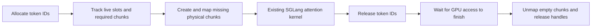

# elastic-kv-vmm

A small research prototype for **demand-backed KV cache memory in SGLang and vLLM**. It reserves stable CUDA virtual addresses, commits physical GPU memory before a token slot is written, and returns unused chunks to the driver.

The repository contains real model-serving experiments, not just allocation arithmetic. It measures the memory/latency trade-off of layouts and allocator policies with Qwen3-0.6B-Base and Qwen3-4B on an A100 80GB, and request-level HiSparse residency with MiniMax-M3.1-Flash on four A100 80GB GPUs.

**Dense SGLang scope:** the measured baseline is **0.5.2**, dense MHA, one GPU, BF16, Triton attention, token page size 1, eager or CUDA Graph execution, with overlap scheduling and prefix caching disabled. V4/V5 support tested exact and padded Graph batches on that version. The startup adapter also recognizes the newer `KVCacheConfigurator` / `mem_cache` pool API; that path has API-level tests but still needs an A100 serving run before it carries performance claims. **vLLM scope:** **0.29.0**, legacy runner in the V1 engine, TP1, eager, one homogeneous full-attention cache group, block size 16 in the experiments. **MiniMax scope:** a separate pinned development image, TP4, eager, native sparse Top-K and HiSparse; all comparison arms share an explicit SM80 projection compatibility adapter. All serving adapters preserve engine slot/block indexing. Removing software paging and prefix-tree redesign are [deferred research](docs/ROADMAP.md). The project does not implement UnifiedKVPool's Mamba/SWA/Full topology or a production allocator.

The [Phase 2 report](docs/RESULTS_PHASE2.md) covers allocator optimization, Graph support, retained backing and application-level capacity. In a same-GPU experiment with an idle 0.6B co-tenant and a burst of 40 long 4B requests, V5 increased throughput from **484 to 614 output tokens/s** and reduced TTFT p95 from **29.96 to 15.46 s**. The static baseline's second model received less logical KV capacity at startup because the first model had already reserved its physical pool. A manually tuned static allocation reached **637 tokens/s**. V5 retains the first model's larger logical capacity, but its median request latency increases relative to the ordinary static baseline. This is evidence about stranded capacity and queue tails, not a general kernel speedup.

The new launch and worker-install path has a separate real-service smoke in [the framework report](docs/SGLANG_FRAMEWORK_SMOKE.md). The checked-in run verifies eager and graph-pad execution, exact probe agreement, VMM backing telemetry and whole-device memory at commit `699181e`; later adapter changes still need a matching real-service rerun, and the two repeats are preliminary evidence rather than a replacement for Phase 2.

The optional future-aware scheduler hook has its own [scheduler report](docs/FUTURE_SCHEDULER_SMOKE.md). It reordered a hinted two-request queue inside native SGLang and retained native order for unhinted traffic. The dense V5 integration smoke also exercised the same hint transport, VMM backing and queue hook in one SGLang 0.5.2 process, in both eager and CUDA Graph modes.

The [MiniMax integration report](docs/MINIMAX_FUTURE_INTEGRATION.md) records a stronger composition check: native sparse HiSparse, VMM backing, request-level residency, automatic joint demotion and future-aware ordering all ran in the same four-A100 server process. The checked-in runs show that the mechanisms compose and that two requests can jointly release physical chunks that neither request alone can free. They do **not** show a stable throughput win: sequential runs have a clear warmup/order effect, and the future-aware arm improved TTFT in one pressure run while regressing TPOT.

## Request-level HiSparse

The MiniMax prototype lets selected long requests keep full GPU history while other requests use the native CPU history and fixed GPU hot buffer. Under a main-KV backing budget, it can demote and promote active requests at safe eager boundaries. The sparse attention selection remains unchanged in both modes. VMM reclaims whole physical chunks after their page references disappear.

A measured shared-chunk layout exposes a limitation of choosing requests by length alone: each of two requests can release 64 software pages without freeing any complete chunk. Joint planning releases 120 chunks, **240 MiB per rank**. An automatic round trip passed full source/destination KV byte checks on all four ranks. This establishes tested data movement and physical reclamation; serving efficiency and whole-device memory are measured separately.

The one-repeat serving pilots show small gains and regressions across workloads, not a uniform speedup. Idle whole-device memory decreases, while the concurrent peak can increase. The three-repeat native baseline and a focused 12K pressure/integration matrix are complete; the remaining full five-workload static and fully resident pairs still await an exclusive GPU window after a startup failure and subsequent external occupancy. Completed results and the failed-start record are preserved separately.

See the [Chinese research report](docs/HISPARSE_REPORT_ZH.md), [future/VMM integration evidence](docs/MINIMAX_FUTURE_INTEGRATION.md), [architecture](docs/HISPARSE_ARCHITECTURE.md), [correctness evidence](docs/HISPARSE_VALIDATION.md), [policy limits](docs/HISPARSE_POLICY_LIMITS.md), and [reproduction commands](docs/HISPARSE_REPRODUCE.md). This path does not yet cover CUDA Graph, overlap, prefix caching or real activation allocation. The earlier dense Graph results do not validate the MiniMax integration.

## Isolated next-stage experiments

The [experimental VMM modules](experimental/README.md) now include a fixed-position
request layout and resident arena, a matched gather benchmark with/without two
software slot lookups, and a category-based runtime budget ledger. CPU checks pass;
the new CUDA/Triton path has not run on a GPU and is not installed in SGLang. These
modules do not establish software-page-table removal in model serving or OOM
prevention. The existing MiniMax formal comparisons remain a separate milestone.

## Dense experiments

The single-model layout/Graph arms use the same 32,768-token logical KV capacity, 8,192 context limit and 2,048-token prefill chunk. Activation and co-tenant experiments declare their separate settings. Model snapshots are mounted read-only. Fixed seeds generate synthetic token inputs; inference runs through real HTTP requests, prefill, decode and streaming responses.

| Arm | Backing and policy | Question |
|---|---|---|
| `baseline` | SGLang's fixed, preallocated per-layer KV tensors | Reference memory and serving efficiency |
| `v0` | Independent K/V plane reservations; 2 MiB chunks; GPU IDs copied to CPU for residency tracking | Does real runtime reclamation work? |
| `v1` | One token-major reservation; the same tracking policy | Can packing avoid per-plane granularity waste? |
| `v2` | Token-major layout, host low-ID reuse, 4 MiB growth headroom, reclaim at idle | Do fewer ID synchronizations and less mapping churn help? |
| `v3` | Contiguous K/V planes in one padded reservation; batch their mappings; host ID allocation | Can the original attention layout be preserved while batching VMM work? |
| `v4` | `v3` plus slices of a persistent GPU ID table for contiguous allocations | Can the common decode path avoid uploading token IDs? |
| `v5` | `v4` plus disjoint free intervals, scalar free count and range-based admission | Can allocation avoid scanning the entire logical pool? |
| `v5-keep8` | V5 with up to eight already-mapped chunks retained per K/V plane after idle | How much remapping overhead can a bounded warm reserve remove? |

Three measured repetitions cover short serial requests, short concurrent requests, long concurrent requests and mixed lengths. Warmups are excluded. Twelve separate, fixed-order, batch-size-one greedy probes provide a controlled token-by-token comparison between arms.

Historical V0–V4 results are in [the Phase 1 report](docs/RESULTS.md); current comparisons are in [Phase 2](docs/RESULTS_PHASE2.md). [Measurement details](docs/MEASUREMENT.md) define TTFT, TPOT, throughput and the boundaries of the comparison. Raw request timings, 50 ms NVML samples and correctness token IDs accompany the reports. Single-model percentiles use linear interpolation; the capacity experiment explicitly uses nearest-rank p95.

With V4, whole-device idle memory fell from **6.304 to 2.804 GiB** on 0.6B and from **13.850 to 9.350 GiB** on 4B. Throughput decreased by 2.8–5.6% and 0.2–2.3%, respectively, across the four workloads. The 4B mixed workload's TTFT increased by about 27%. A separate V2 two-instance run reduced the both-active sampled peak from **19.366 to 12.225 GiB**, with aggregate throughput decreasing 2.4%. These are workload-specific measurements with three repeats, not full-capacity or production-serving guarantees.

“End to end” here means HTTP submission of `input_ids` through receipt of the generated response. Prompt tokenization, model loading and compilation are outside the timed interval. These inputs test execution and capacity, not answer quality.

## Memory mechanism



`cuMemAddressReserve` reserves virtual addresses only. Physical storage is created by `cuMemCreate`, mapped by `cuMemMap`, and made accessible by `cuMemSetAccess`. Reclamation uses both `cuMemUnmap` and `cuMemRelease`; there is no hidden physical-handle cache. Sink storage remains mapped. A chunk shared by multiple live token slots cannot be reclaimed until all users release it.

This differs from CUDA Unified/Managed Memory: there is no CPU page migration or fault-driven oversubscription here. It also differs from merely returning a token ID to a free list, which leaves a preallocated pool's physical memory intact.

## Reproduce

Use Linux, a CUDA VMM-capable GPU, a compatible NVIDIA driver, CUDA headers and a C++17 compiler. The measured software versions are in [environment.json](environment.json); [requirements.txt](requirements.txt) records the Python stack. The runs used an existing environment with CUDA 12.8 PyTorch. A fresh image rebuild from these requirements has not been validated.

Build the small driver-API library:

```bash
g++ -std=c++17 -O2 -Wall -Wextra -shared -fPIC \
  -I/usr/local/cuda/include native/elastic_vmm.cpp -lcuda \
  -o native/libelastic_vmm.so
python3 -m unittest discover -s tests -v
```

Prepare a local container image with the recorded stack and set `SGLANG_IMAGE` to its tag. `container_case.sh` checks that the selected GPU is idle, disables external networking, mounts the model hub read-only and directs generated caches into this project's `cache/` directory. Mount the whole Hugging Face hub so snapshot symlinks can still resolve to `blobs/`.

```bash
export SGLANG_IMAGE=your-local-sglang-0.5.2-image
MODEL_HUB=/path/to/existing/huggingface/hub
MODEL_REL=models--Qwen--Qwen3-0.6B-Base/snapshots/da87bfb608c14b7cf20ba1ce41287e8de496c0cd
bash scripts/container_case.sh 0 "$MODEL_HUB" "$MODEL_REL" \
  Qwen3-0.6B-Base v5 results/my-v5-run 3
```

Use a fresh output directory for every run. Substitute `baseline` or `v0`–`v4` for ablations. Set `EKV_EXECUTION=graph-pad` for capture batches 1, 2, 4, 8 (including additional 3/5/3-request padding probes), or `graph` for exact batches 1–8. `EKV_RETAIN_CHUNKS=8` selects the warm retention policy. These are environment variables on the container script. The Qwen3-4B snapshot revision is recorded in `environment.json`. Never copy weights into this repository.

For an existing isolated environment, the primary entry point is `python3 -m elastic_kv` (or `elastic-sglang` after installing `pyproject.toml`). It validates elastic settings before importing SGLang, installs the adapter, and forwards the remaining arguments to SGLang. `python3 -m elastic_kv.launch` remains compatible with the experiment scripts. The module entry point is required so the adapter is installed in the spawned scheduler process as well as the launcher. See [server usage](docs/SERVER.md); `EKV_STATS_PATH` optionally records residency telemetry.

For the separate future-ordering path, set `EKV_FUTURE_POLICY=deadline` and
optionally `EKV_FUTURE_STATS_PATH=/path/to/future-stats.json`. On SGLang 0.5.2,
the launcher installs a small request-transport compatibility layer before the
HTTP server imports its request dataclass. Revisions with native `kv_hints` keep
their own implementation. The VMM adapter and future-ordering hook can therefore
share one process without changing sampling or attention behavior. See [the
compatibility boundary](docs/KV_HINTS_COMPAT.md), [scheduler integration
design](docs/FUTURE_PLANNER_DESIGN.md), and [smoke script](scripts/container_future_smoke.sh).

The MiniMax request-residency path can consume the same hint. With
`--resident-hint-policy adaptive`, `host_backed` yields a complete-GPU KV slot,
`resident` requests one when capacity and the per-rank reserve permit it, and
`auto` uses the predicted output length. The policy is opt-in and remains below
SGLang's native admission and physical-reserve checks. Its paired GPU experiment
is specified in the [HiSparse reproduction guide](docs/HISPARSE_REPRODUCE.md).

The optional `--resident-broker dry_run|enforce` path adds a second admission
check: predicted output-token growth, the fixed allocator reserve and every
already promised resident growth share one physical-byte ledger. `dry_run`
records whether the claim would fit without changing placement; `enforce`
falls back to native HiSparse when the complete future cannot fit. The broker
rounds predictions to the allocator's page geometry, consumes reservations at
page boundaries, follows demotion/promotion transitions, and returns the
remainder at request completion. It is disabled by default. The complete CPU
suite passes in the SGLang 0.5.17 image; a real serving run is still required
to establish transition and timing behavior.

Summarize only explicitly selected completed runs:

```bash
python3 benchmarks/summarize.py \
  --case Qwen3-0.6B-Base:baseline:results/my-baseline \
  --case Qwen3-0.6B-Base:v5:results/my-v5-run \
  --output-dir results/summary
python3 benchmarks/plot.py results/summary/summary.json --output-dir docs/figures
```

The summarizer rejects incomplete runs, mismatched input prompts, missing probe coverage and token-ID disagreements. Plotting additionally requires matplotlib. Phase 2 reproduction commands, capacity controls and activation tests are described in [the protocol](docs/PHASE2_PROTOCOL.md). The [vLLM adapter](vllm_integration/README.md) has its own runner, baseline and software environment. Do not interpret the two engines' numbers as a controlled comparison between engines.

## Integration points and limitations

The adapter replaces `MHATokenToKVPool._create_buffers` and the plain `TokenToKVPoolAllocator` selected by `ModelRunner.init_memory_pool`. It guards unsupported configurations at startup and preserves the existing attention interface. The source SGLang installation is not modified on disk.

See the [integration map](docs/INTEGRATION.md) for changed components, Graph lifetimes, prefill pressure coordination and the remaining work for mixed state pools and cross-instance admission.

- VMM admission completes before the allocator publishes IDs to the forward pass. Reclamation waits for device work to finish. Slot zero remains backed.
- `v0` and `v1` reclaim empty chunks on logical frees. The later arms defer reclamation until the instance is idle; they therefore do not promise prompt return of all slack under a permanently busy workload.
- A fixed virtual address is not sufficient to make arbitrary unmapping safe. SGLang Graph padding uses a permanently backed sink row and maps real slots before replay. Overlap scheduling, speculative decoding, HiCache/PD transfers, prefix-cache retention and hybrid recurrent states remain unsupported. vLLM Graph execution remains unsupported.
- CUDA allocation failures are fail-stop. A successfully mapped earlier plane may remain allocated until worker teardown if a later plane fails. There is no tested transactional OOM recovery, multi-tenant fairness or process-failure broker.
- Two instances can independently release unused backing to the driver. The shared-GPU experiment does not implement a global admission broker, transfer live KV, force physical OOM or demonstrate safe preemption of another model.
- Optional V5 activation policies measure prefill demand, trim unused retained KV chunks before prefill under pressure, and return actually releasable PyTorch cache before new VMM commitment. They never evict live KV or release Graph pools. Headroom is empirical; unresolved pressure is recorded, not converted into scheduler backpressure. This is not a guaranteed activation-budget lender or OOM recovery system.

## Related work

VMM-backed attention and elastic multi-model memory are established research directions. [vAttention](https://arxiv.org/abs/2405.04437), [Prism](https://arxiv.org/abs/2505.04021), and [Elastic KV Cache](https://arxiv.org/abs/2608.23658) are relevant prior work. This project is a measured implementation study of layout, residency and synchronization trade-offs; it does not claim that using CUDA VMM alone is novel.

Implementation references: [CUDA Driver VMM API](https://docs.nvidia.com/cuda/cuda-driver-api/cuda_driver_api/group__CUDA__VA.html), [SGLang 0.5.2 memory pool](https://github.com/sgl-project/sglang/blob/v0.5.2/python/sglang/srt/mem_cache/memory_pool.py), and [token allocator](https://github.com/sgl-project/sglang/blob/v0.5.2/python/sglang/srt/mem_cache/allocator.py).

Apache-2.0. No model weights, machine credentials, private host addresses or original machine logs are included.
