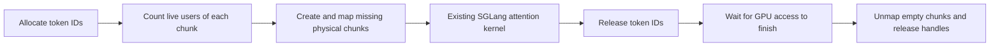

# elastic-kv-vmm

A small research prototype for **demand-backed KV cache memory in SGLang**. It reserves stable CUDA virtual addresses, commits physical GPU memory before a token slot is written, and returns empty chunks to the driver after their users finish.

The repository contains real model-serving experiments, not just allocation arithmetic. It measures the memory/latency trade-off of several layouts and allocator policies with Qwen3-0.6B-Base and Qwen3-4B on an A100 80GB.

**Scope:** SGLang **0.5.2**, dense MHA, one GPU, BF16, Triton attention, token page size 1, eager execution, overlap scheduling and prefix caching disabled. Existing attention kernels and token IDs are retained. This is **not a removal of PagedAttention**, not an implementation of UnifiedKVPool's Mamba/SWA/Full topology, and not a production allocator.

## Experiments

All arms use the same 32,768-token logical KV capacity, 8,192 context limit and 2,048-token prefill chunk. Model snapshots are mounted read-only. Fixed seeds generate synthetic token inputs; inference runs through real HTTP requests, prefill, decode and streaming responses.

| Arm | Backing and policy | Question |
|---|---|---|
| `baseline` | SGLang's fixed, preallocated per-layer KV tensors | Reference memory and serving efficiency |
| `v0` | Independent K/V plane reservations; 2 MiB chunks; GPU IDs copied to CPU for residency tracking | Does real runtime reclamation work? |
| `v1` | One token-major reservation; the same tracking policy | Can packing avoid per-plane granularity waste? |
| `v2` | Token-major layout, host low-ID reuse, 4 MiB growth headroom, reclaim at idle | Do fewer ID synchronizations and less mapping churn help? |
| `v3` | Contiguous K/V planes in one padded reservation; batch their mappings; host ID allocation | Can the original attention layout be preserved while batching VMM work? |
| `v4` | `v3` plus slices of a persistent GPU ID table for contiguous allocations | Can the common decode path avoid uploading token IDs? |

Three measured repetitions cover short serial requests, short concurrent requests, long concurrent requests and mixed lengths. Warmups are excluded. Twelve separate, fixed-order, batch-size-one greedy probes provide a controlled token-by-token comparison between arms.

Results and plots are collected in [the experiment report](docs/RESULTS.md). [Measurement details](docs/MEASUREMENT.md) define TTFT, TPOT, throughput and the boundaries of the comparison. Raw request timings, 50 ms NVML samples and correctness token IDs accompany the report.

With V4, whole-device idle memory fell from **6.304 to 2.804 GiB** on 0.6B and from **13.850 to 9.350 GiB** on 4B. Throughput decreased by 2.8–5.6% and 0.2–2.3%, respectively, across the four workloads. The 4B mixed workload's TTFT increased by about 27%. A separate V2 two-instance run reduced the both-active sampled peak from **19.366 to 12.225 GiB**, with aggregate throughput decreasing 2.4%. These are workload-specific measurements with three repeats, not full-capacity or production-serving guarantees.

“End to end” here means HTTP submission of `input_ids` through receipt of the generated response. Prompt tokenization, model loading and compilation are outside the timed interval. These inputs test execution and capacity, not answer quality.

## Memory mechanism



`cuMemAddressReserve` reserves virtual addresses only. Physical storage is created by `cuMemCreate`, mapped by `cuMemMap`, and made accessible by `cuMemSetAccess`. Reclamation uses both `cuMemUnmap` and `cuMemRelease`; there is no hidden physical-handle cache. Sink storage remains mapped. A chunk shared by multiple live token slots cannot be reclaimed until all users release it.

This differs from CUDA Unified/Managed Memory: there is no CPU page migration or fault-driven oversubscription here. It also differs from merely returning a token ID to a free list, which leaves a preallocated pool's physical memory intact.

## Reproduce

Use Linux, a CUDA VMM-capable GPU, a compatible NVIDIA driver, CUDA headers and a C++17 compiler. The measured software versions are in [environment.json](environment.json); [requirements.txt](requirements.txt) records the Python stack. The runs used an existing environment with CUDA 12.8 PyTorch. A fresh image rebuild from these requirements has not been validated.

Build the small driver-API library:

```bash
g++ -std=c++17 -O2 -Wall -Wextra -shared -fPIC \
  -I/usr/local/cuda/include native/elastic_vmm.cpp -lcuda \
  -o native/libelastic_vmm.so
python3 -m unittest discover -s tests -v
```

Prepare a local container image with the recorded stack and set `SGLANG_IMAGE` to its tag. `container_case.sh` checks that the selected GPU is idle, disables external networking, mounts the model hub read-only and directs generated caches into this project's `cache/` directory. Mount the whole Hugging Face hub so snapshot symlinks can still resolve to `blobs/`.

```bash
export SGLANG_IMAGE=your-local-sglang-0.5.2-image
MODEL_HUB=/path/to/existing/huggingface/hub
MODEL_REL=models--Qwen--Qwen3-0.6B-Base/snapshots/da87bfb608c14b7cf20ba1ce41287e8de496c0cd
bash scripts/container_case.sh 0 "$MODEL_HUB" "$MODEL_REL" \
  Qwen3-0.6B-Base v4 results/my-v4-run 3
```

Use a fresh output directory for every run. Substitute `baseline`, `v0`, `v1`, `v2` or `v3` to run the ablations. The Qwen3-4B snapshot revision is recorded in `environment.json`. Never copy weights into this repository.

For an existing isolated environment, the direct entry point is `python3 -m elastic_kv.launch` with the supported flags in `scripts/run_case.py`. The module entry point is required: it installs the adapter in the spawned scheduler process as well as the launcher. `EKV_MODE` selects the arm; `EKV_STATS_PATH` optionally records residency telemetry.

Summarize only explicitly selected completed runs:

```bash
python3 benchmarks/summarize.py \
  --case Qwen3-0.6B-Base:baseline:results/my-baseline \
  --case Qwen3-0.6B-Base:v4:results/my-v4-run \
  --output-dir results/summary
python3 benchmarks/plot.py results/summary/summary.json --output-dir docs/figures
```

The summarizer rejects incomplete runs, mismatched input prompts, missing probe coverage and token-ID disagreements. Plotting additionally requires matplotlib. `scripts/run_dual.py` tests two model servers on one GPU; its shared-GPU experiment is separate from the single-instance ablations. Run it via `bash scripts/container_dual.sh 0 "$MODEL_HUB" v2 results/my-dual-v2`, with the two recorded snapshots already available. Reproduce the published dual tables with `python3 benchmarks/summarize_dual.py results/dual`.

## Integration points and limitations

The adapter replaces `MHATokenToKVPool._create_buffers` and the plain `TokenToKVPoolAllocator` selected by `ModelRunner.init_memory_pool`. It guards unsupported configurations at startup and preserves the existing attention interface. The source SGLang installation is not modified on disk.

See the [integration map](docs/INTEGRATION.md) for the changed components and the additional work needed for mixed state pools, cross-instance admission and prefill activation lending.

- VMM admission completes before the allocator publishes IDs to the forward pass. Reclamation waits for device work to finish. Slot zero remains backed.
- `v0` and `v1` reclaim empty chunks on logical frees. The later arms defer reclamation until the instance is idle; they therefore do not promise prompt return of all slack under a permanently busy workload.
- A fixed virtual address is not sufficient to make arbitrary unmapping safe. CUDA Graph replay, overlap scheduling, speculative decoding, HiCache/PD transfers, prefix-cache retention and hybrid recurrent states require additional lifetime protocols and are not supported here.
- CUDA allocation failures are fail-stop. A successfully mapped earlier plane may remain allocated until worker teardown if a later plane fails. There is no tested transactional OOM recovery, multi-tenant fairness or process-failure broker.
- Two instances can independently release unused backing to the driver. The shared-GPU experiment does not implement a global admission broker, transfer live KV, force physical OOM or demonstrate safe preemption of another model.
- Prefill activation-budget lending is not implemented. Extending the mechanism needs prefill admission, reclaimable KV semantics and coordination with PyTorch's caching allocator and Graph pools.

## Related work

VMM-backed attention and elastic multi-model memory are established research directions. [vAttention](https://arxiv.org/abs/2405.04437), [Prism](https://arxiv.org/abs/2505.04021), and [Elastic KV Cache](https://arxiv.org/abs/2608.23658) are relevant prior work. This project is a measured implementation study of layout, residency and synchronization trade-offs; it does not claim that using CUDA VMM alone is novel.

Implementation references: [CUDA Driver VMM API](https://docs.nvidia.com/cuda/cuda-driver-api/cuda_driver_api/group__CUDA__VA.html), [SGLang 0.5.2 memory pool](https://github.com/sgl-project/sglang/blob/v0.5.2/python/sglang/srt/mem_cache/memory_pool.py), and [token allocator](https://github.com/sgl-project/sglang/blob/v0.5.2/python/sglang/srt/mem_cache/allocator.py).

Apache-2.0. No model weights, machine credentials, private host addresses or original machine logs are included.
