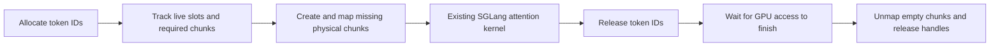

# elastic-kv-vmm

A small research prototype for **demand-backed KV cache memory in SGLang and vLLM**. It reserves stable CUDA virtual addresses, commits physical GPU memory before a token slot is written, and returns unused chunks to the driver.

The repository contains real model-serving experiments, not just allocation arithmetic. It measures the memory/latency trade-off of layouts and allocator policies with Qwen3-0.6B-Base and Qwen3-4B on an A100 80GB, and request-level HiSparse residency with MiniMax-M3.1-Flash on four A100 80GB GPUs.

**Dense SGLang scope:** the measured baseline is **0.5.2**, dense MHA, one GPU, BF16, Triton attention, token page size 1, eager or CUDA Graph execution, with overlap scheduling and prefix caching disabled. V5 now has an explicit `--elastic-allow-overlap-schedule` opt-in that keeps the V5 synchronization-before-reclaim fence; it still needs a serving comparison. V4/V5 support tested exact and padded Graph batches on that version. The startup adapter also recognizes the newer `KVCacheConfigurator` / `mem_cache` pool API; that path has API-level tests but still needs an A100 serving run before it carries performance claims. **vLLM scope:** **0.29.0**, legacy runner in the V1 engine, TP1, eager, one homogeneous full-attention cache group, block size 16 in the experiments. **MiniMax scope:** a separate pinned development image, TP4, eager, native sparse Top-K and HiSparse; all comparison arms share an explicit SM80 projection compatibility adapter. All serving adapters preserve engine slot/block indexing. Removing software paging and prefix-tree redesign are [deferred research](docs/ROADMAP.md). The project does not implement UnifiedKVPool's Mamba/SWA/Full topology or a production allocator.

The [Phase 2 report](docs/RESULTS_PHASE2.md) covers allocator optimization, Graph support, retained backing and application-level capacity. In a same-GPU experiment with an idle 0.6B co-tenant and a burst of 40 long 4B requests, V5 increased throughput from **484 to 614 output tokens/s** and reduced TTFT p95 from **29.96 to 15.46 s**. The static baseline's second model received less logical KV capacity at startup because the first model had already reserved its physical pool. A manually tuned static allocation reached **637 tokens/s**. V5 retains the first model's larger logical capacity, but its median request latency increases relative to the ordinary static baseline. This is evidence about stranded capacity and queue tails, not a general kernel speedup.

The new launch and worker-install path has a separate real-service smoke in [the framework report](docs/SGLANG_FRAMEWORK_SMOKE.md). The checked-in run verifies eager and graph-pad execution, exact probe agreement, VMM backing telemetry and whole-device memory at commit `699181e`; later adapter changes still need a matching real-service rerun, and the two repeats are preliminary evidence rather than a replacement for Phase 2.

The optional future-aware scheduler hook has its own [scheduler report](docs/FUTURE_SCHEDULER_SMOKE.md). It reordered a hinted two-request queue inside native SGLang and retained native order for unhinted traffic. The dense V5 integration smoke also exercised the same hint transport, VMM backing and queue hook in one SGLang 0.5.2 process, in both eager and CUDA Graph modes.

The [MiniMax integration report](docs/MINIMAX_FUTURE_INTEGRATION.md) records a stronger composition check: native sparse HiSparse, VMM backing, request-level residency, automatic joint demotion and future-aware ordering all ran in the same four-A100 server process. The checked-in runs show that the mechanisms compose and that two requests can jointly release physical chunks that neither request alone can free. They do **not** show a stable throughput win: sequential runs have a clear warmup/order effect, and the future-aware arm improved TTFT in one pressure run while regressing TPOT.

The joint pressure path now supports bounded two-to-four-request planning. It ranks only groups that can release at least one complete physical chunk on every TP rank, keeps the existing dwell and byte caps, and records how many owner closures were evaluated or truncated. An incremental page/chunk owner index follows shared chunks across pressure ticks; exact page-union enumeration remains a fallback for overlapping request pages. The [candidate-search microbenchmark](docs/GROUP_INDEX_MICROBENCH.md) reduced a 32-request synthetic search from 256 examined combinations to 0–16 owner closures and from roughly 0.73–0.95 ms to 0.09–0.20 ms on CPU. CPU coverage includes the three-owner shared-chunk case; GPU placement, migration cost and end-to-end benefit still require the pending serving comparison.

Successful demotions and promotions now update direction-specific EWMA transfer bandwidth from real transferred bytes and elapsed time. Setting `EKV_ADAPTIVE_MIGRATION_TIME_CAP_MS` lowers the startup byte admission cap to what the observed rate can transfer inside that time window. The fixed byte cap remains a hard bound, forced diagnostics bypass both, and telemetry separates fixed-cap from time-cap rejections. CPU coverage validates initialization, sample EWMA, ignored zero samples, direction isolation, single/group admission and TP-safe common-candidate behavior. The initial bandwidth is a configured fallback rather than a claim about the target machine's copy rate; real serving calibration is still required.

## Request-level HiSparse

The MiniMax prototype lets selected long requests keep full GPU history while other requests use the native CPU history and fixed GPU hot buffer. Under a main-KV backing budget, it can demote and promote active requests at safe eager boundaries. The sparse attention selection remains unchanged in both modes. VMM reclaims whole physical chunks after their page references disappear.

A measured shared-chunk layout exposes a limitation of choosing requests by length alone: each of two requests can release 64 software pages without freeing any complete chunk. Joint planning releases 120 chunks, **240 MiB per rank**. An automatic round trip passed full source/destination KV byte checks on all four ranks. This establishes tested data movement and physical reclamation; serving efficiency and whole-device memory are measured separately.

The one-repeat serving pilots show small gains and regressions across workloads, not a uniform speedup. Idle whole-device memory decreases, while the concurrent peak can increase. The three-repeat native baseline and a focused 12K pressure/integration matrix are complete; the remaining full five-workload static and fully resident pairs still await an exclusive GPU window after a startup failure and subsequent external occupancy. Completed results and the failed-start record are preserved separately.

See the [Chinese research report](docs/HISPARSE_REPORT_ZH.md), [future/VMM integration evidence](docs/MINIMAX_FUTURE_INTEGRATION.md), [architecture](docs/HISPARSE_ARCHITECTURE.md), [correctness evidence](docs/HISPARSE_VALIDATION.md), [policy limits](docs/HISPARSE_POLICY_LIMITS.md), and [reproduction commands](docs/HISPARSE_REPRODUCE.md). This path does not yet cover CUDA Graph, overlap, prefix caching or real activation allocation. The earlier dense Graph results do not validate the MiniMax integration.

## Isolated next-stage experiments

The [experimental VMM modules](experimental/README.md) now include a fixed-position
request layout and resident arena, a matched gather benchmark with/without two
software slot lookups, and a category-based runtime budget ledger. CPU checks pass;
the new CUDA/Triton path has not run on a GPU and is not installed in SGLang. These
modules do not establish software-page-table removal in model serving or OOM
prevention. The existing MiniMax formal comparisons remain a separate milestone.

## Dense experiments

The single-model layout/Graph arms use the same 32,768-token logical KV capacity, 8,192 context limit and 2,048-token prefill chunk. Activation and co-tenant experiments declare their separate settings. Model snapshots are mounted read-only. Fixed seeds generate synthetic token inputs; inference runs through real HTTP requests, prefill, decode and streaming responses.

| Arm | Backing and policy | Question |
|---|---|---|
| `baseline` | SGLang's fixed, preallocated per-layer KV tensors | Reference memory and serving efficiency |
| `v0` | Independent K/V plane reservations; 2 MiB chunks; GPU IDs copied to CPU for residency tracking | Does real runtime reclamation work? |
| `v1` | One token-major reservation; the same tracking policy | Can packing avoid per-plane granularity waste? |
| `v2` | Token-major layout, host low-ID reuse, 4 MiB growth headroom, reclaim at idle | Do fewer ID synchronizations and less mapping churn help? |
| `v3` | Contiguous K/V planes in one padded reservation; batch their mappings; host ID allocation | Can the original attention layout be preserved while batching VMM work? |
| `v4` | `v3` plus slices of a persistent GPU ID table for contiguous allocations | Can the common decode path avoid uploading token IDs? |
| `v5` | `v4` plus disjoint free intervals, scalar free count and range-based admission | Can allocation avoid scanning the entire logical pool? |
| `v5-keep8` | V5 with up to eight already-mapped chunks retained per K/V plane after idle | How much remapping overhead can a bounded warm reserve remove? |

Three measured repetitions cover short serial requests, short concurrent requests, long concurrent requests and mixed lengths. Warmups are excluded. Twelve separate, fixed-order, batch-size-one greedy probes provide a controlled token-by-token comparison between arms.

Historical V0–V4 results are in [the Phase 1 report](docs/RESULTS.md); current comparisons are in [Phase 2](docs/RESULTS_PHASE2.md). [Measurement details](docs/MEASUREMENT.md) define TTFT, TPOT, throughput and the boundaries of the comparison. Raw request timings, 50 ms NVML samples and correctness token IDs accompany the reports. Single-model percentiles use linear interpolation; the capacity experiment explicitly uses nearest-rank p95.

With V4, whole-device idle memory fell from **6.304 to 2.804 GiB** on 0.6B and from **13.850 to 9.350 GiB** on 4B. Throughput decreased by 2.8–5.6% and 0.2–2.3%, respectively, across the four workloads. The 4B mixed workload's TTFT increased by about 27%. A separate V2 two-instance run reduced the both-active sampled peak from **19.366 to 12.225 GiB**, with aggregate throughput decreasing 2.4%. These are workload-specific measurements with three repeats, not full-capacity or production-serving guarantees.

“End to end” here means HTTP submission of `input_ids` through receipt of the generated response. Prompt tokenization, model loading and compilation are outside the timed interval. These inputs test execution and capacity, not answer quality.

## Memory mechanism



`cuMemAddressReserve` reserves virtual addresses only. Physical storage is created by `cuMemCreate`, mapped by `cuMemMap`, and made accessible by `cuMemSetAccess`. Reclamation uses both `cuMemUnmap` and `cuMemRelease`; there is no hidden physical-handle cache. Sink storage remains mapped. A chunk shared by multiple live token slots cannot be reclaimed until all users release it.

V5 also has an opt-in request-affine placement policy. In `enforce` mode, a request projected to reach one full VMM chunk receives an aligned private chunk; short requests stay on the packed first-fit path. Partial releases from a live private chunk remain withheld, then a fully empty chunk is returned and unmapped once. Physical admission preflights complete-chunk demand and falls back to packed placement when the budget cannot fund the private layout. `dry_run` leaves placement unchanged and reports cross-request chunk sharing, at the cost of D2H observation. This policy still uses SGLang's software token slots and currently covers dense V5 only. It is available on the SGLang 0.5.2 `alloc_token_slots` boundary and the 0.5.17 `alloc_for_extend`/`alloc_for_decode` boundary. See [Request-affine VMM placement](docs/REQUEST_AFFINE_VMM.md); no serving benefit is claimed until a paired GPU run is available.

This differs from CUDA Unified/Managed Memory: there is no CPU page migration or fault-driven oversubscription here. It also differs from merely returning a token ID to a free list, which leaves a preallocated pool's physical memory intact.

## Reproduce

Use Linux, a CUDA VMM-capable GPU, a compatible NVIDIA driver, CUDA headers and a C++17 compiler. The measured software versions are in [environment.json](environment.json); [requirements.txt](requirements.txt) records the Python stack. The runs used an existing environment with CUDA 12.8 PyTorch. A fresh image rebuild from these requirements has not been validated.

Build the small driver-API library:

```bash
g++ -std=c++17 -O2 -Wall -Wextra -shared -fPIC \
  -I/usr/local/cuda/include native/elastic_vmm.cpp -lcuda \
  -o native/libelastic_vmm.so
python3 -m unittest discover -s tests -v
```

Prepare a local container image with the recorded stack and set `SGLANG_IMAGE` to its tag. `container_case.sh` checks that the selected GPU is idle, disables external networking, mounts the model hub read-only and directs generated caches into this project's `cache/` directory. Mount the whole Hugging Face hub so snapshot symlinks can still resolve to `blobs/`.

```bash
export SGLANG_IMAGE=your-local-sglang-0.5.2-image
MODEL_HUB=/path/to/existing/huggingface/hub
MODEL_REL=models--Qwen--Qwen3-0.6B-Base/snapshots/da87bfb608c14b7cf20ba1ce41287e8de496c0cd
bash scripts/container_case.sh 0 "$MODEL_HUB" "$MODEL_REL" \
  Qwen3-0.6B-Base v5 results/my-v5-run 3
```

Use a fresh output directory for every run. Substitute `baseline` or `v0`–`v4` for ablations. Set `EKV_EXECUTION=graph-pad` for capture batches 1, 2, 4, 8 (including additional 3/5/3-request padding probes), or `graph` for exact batches 1–8. `EKV_RETAIN_CHUNKS=8` selects the warm retention policy. The opt-in `EKV_PRECOMMIT_CHUNKS=1` maps the next logical chunk across every KV plane and starts its required zeroing on an independent CUDA stream; `EKV_PRECOMMIT_MAX_CHUNKS` caps the speculative chunks kept across a mixed workload. These are environment variables on the container script. The Qwen3-4B snapshot revision is recorded in `environment.json`. Never copy weights into this repository.

V5 can also consume the bounded future-prefill plan for predictive physical prewarming. Use `--elastic-predictive-prewarm-mode dry_run|enforce`, `--elastic-predictive-prewarm-ttl-ms`, and `--elastic-predictive-prewarm-max-chunks` through `elastic-sglang`, or the matching `EKV_PREDICTIVE_PREWARM_*` environment variables. These bound `cuMemCreate`/zeroing for slots that SGLang still reports as free. Admission capacity still covers the full future horizon, while physical prewarming maps only requests whose hinted start falls inside the TTL window; when the TTL environment variable is absent, the legacy full-horizon prewarm remains available. Demand is total K/V bytes across every layer plane; the adapter divides that demand by the physical plane count before converting it to logical chunks. The plan never claims a logical token or queue position, native `PrefillAdder` remains authoritative, and scheduler activity or a fully idle tick reclaims an unconsumed lease after its TTL. Capacity control runs before the advisory mapping. Broker denial and VMM failure leave native admission in control, and any uncertain partial mapping disables the predictive path for the rest of the process. Default is `off`; telemetry records requested, candidate, mapped, consumed-hit and expired bytes separately, plus broker-denied, exception, fallback and telemetry-error counts.

Set `EKV_ADMISSION_POLICY=physical` (or use the corresponding launcher option)
with V5 to bound SGLang's allocator `available_size()` by current device free
memory, the configured prefill headroom and the exact cost of committing a new
VMM chunk. Already mapped holes and precommitted chunks remain usable, so the
scheduler reduces an extend or decode batch only when its low-ID free prefix
actually needs unmapped backing.

For two or more processes on one physical GPU, point them at the same SQLite
broker file and give it one aggregate VMM capacity:

```bash
--elastic-global-broker-path /run/ekv/gpu0.sqlite \
--elastic-global-broker-mib 6144 \
--elastic-global-broker-prefill-mode observe
```

Each `Backing` reserves chunk leases before `cuMemMap` and returns them only
after a successful unmap or close; a partial mapping failure or failed teardown
keeps the leases reserved. The generic dense path also subtracts the broker's
current free bytes from native physical admission. For TP or other multi-GPU
launches, pass a directory or a `{gpu}` path template so every physical GPU gets
its own state file, for example `/run/ekv/gpu-{gpu}.sqlite`. Resource metadata
rejects accidental reuse of one file across GPUs.

The opt-in `observe` prefill mode compares the waiting-prompt activation
estimate with the shared broker and records whether it would fit. `enforce`
atomically claims the estimate before SGLang chooses the prefill batch, so a
peer process cannot spend the same VMM headroom first. Once native scheduling
selects a concrete batch, the same claim is atomically shrunk to the selected
tokens' estimate so unconsumed waiting-queue budget becomes available before
the forward starts. The claim is released only after the matching model
forward succeeds; empty batches release it immediately. A failed scheduler or
forward keeps the claim until backend
teardown rather than assuming uncertain activation state is quiescent. This
coordinates the admission budget but leaves PyTorch's activation allocation
outside VMM ownership. Start with `observe`, then compare both arms on the same
GPU; CPU tests alone do not establish a serving throughput benefit.

For cooperative fair sharing between two models, assign every process of one
model a stable tenant and weight. Start with `observe` to verify the target and
demand signals without changing allocation, then use `enforce` when every
participant reaches the scheduler hook:

```bash
--elastic-global-broker-fair-mode enforce \
--elastic-global-broker-tenant qwen-a \
--elastic-global-broker-tenant-weight 3 \
--elastic-global-broker-demand-ttl-seconds 10 \
--elastic-global-broker-wait-ms 0
```

An owner is denied a *new* batch when its prospective usage would exceed the
target while another tenant has an unmet demand. Dense V5 returns no new-growth
budget under the same fairness pressure, and MiniMax treats the signal as
pressure before aggregate exhaustion. The broker never unmaps another
process's live KV. Wait-based retry is optional and
limited to 5 seconds because it can delay the calling scheduler.

MiniMax also samples the same tenant signal when a new request would claim a
complete-GPU KV history. `observe` records `global_fair_claim_would_yield`
without changing placement; `enforce` turns live fairness pressure into a
native-HiSparse admission on every TP rank. This prevents a resident request
from taking memory that the scheduler would immediately try to reclaim. The
request stays on the native hot-set path until a later safe promotion boundary.

The MiniMax scheduler can consume the same broker state. Set
`EKV_ADAPTIVE_GLOBAL_BROKER_HEADROOM_BYTES` to the local VMM bytes it should
keep available and `EKV_ADAPTIVE_GLOBAL_BROKER_LOW_BYTES` to the higher recovery
watermark. Aggregate exhaustion then triggers the existing safe demotion path,
and promotion waits for stable recovery. Both values are required together and
the low watermark must be higher. This is cooperative pressure, not a command
to forcibly unmap another process: every participating instance must run a
scheduler boundary. The mechanism covers VMM-backed KV only, uses first-come
leases by default, and does not include weights, PyTorch workspace or activation
allocations. `observe` and `enforce` modes add explicit tenant ids, positive
weights and short-lived demand records for weighted soft fairness; they still
cannot preempt live KV in a process that does not participate. See the
[cross-instance broker design](docs/GLOBAL_VMM_BROKER_ZH.md)
for lease lifetimes, failure semantics, multi-GPU state paths and the paired
validation matrix. The dense [dual-instance runner](scripts/run_dual.py) now
accepts one fresh broker file plus per-model tenant and weight values, samples
broker capacity/usage/demand and whole-device NVML together, and runs `a-hot`,
`b-hot`, `a-to-b`, `b-to-a` and `both-active` phases. Transition phases dispatch
the incumbent first and the incoming model after a configurable gap. The runner
records the observed overlap, overlap-token throughput and fails the phase when
a transition actually ran serially. Dispatch is barrier-synchronized,
hot-instance order reverses across repeats, and source/runtime/native/model/image
provenance is recorded. Raw request/sample files are written separately from summarized
results, and an untimed non-streaming token matrix is retained for paired
correctness checks. `--requests-per-instance`, `--input-tokens` and
`--output-tokens` make pressure runs explicit; each phase records the model's
dense KV bytes/token and the estimated phase-demand to broker-capacity ratio.
Optional `--arrival-delay-a-ms` / `--arrival-delay-b-ms` create a recorded
unfair-arrival schedule after the common dispatch barrier, while
`--transition-gap-ms` controls the incoming instance in both transition phases.
The full arm and acceptance protocol is in
the [dual-instance validation plan](docs/DUAL_INSTANCE_VALIDATION_ZH.md).

`EKV_PREFILL_HEADROOM_SCOPED=1` (or `--elastic-prefill-headroom-scoped`) makes
the static fallback apply only while native prefill admission is active.
`EKV_PREFILL_WORKSPACE_BYTES_PER_TOKEN` adds a bounded, model-calibrated estimate
from the waiting queue's remaining prompt tokens; `EKV_PREFILL_WORKSPACE_MAX_MIB`
caps it. The larger of this estimate and the static fallback enters the same VMM
gate. The estimate is a phase-scoped lease around scheduler admission, not a
separate activation allocator; GPU measurements must calibrate the rate and
validate OOM behavior.

For an existing isolated environment, the primary entry point is `python3 -m elastic_kv` (or `elastic-sglang` after installing `pyproject.toml`). It validates elastic settings before importing SGLang, installs the adapter, and forwards the remaining arguments to SGLang. The launcher now owns precommit lookahead, future-ordering horizon and both telemetry destinations as well as their `EKV_*` environment equivalents, so spawned SGLang workers receive one validated manifest. `python3 -m elastic_kv.launch` remains compatible with the experiment scripts. The module entry point is required so the adapter is installed in the spawned scheduler process as well as the launcher. See [server usage](docs/SERVER.md); `EKV_STATS_PATH` optionally records residency telemetry.

For the separate future-ordering path, set `EKV_FUTURE_POLICY=deadline` and
optionally `EKV_FUTURE_STATS_PATH=/path/to/future-stats.json`. On SGLang 0.5.2,
the launcher installs a small request-transport compatibility layer before the
HTTP server imports its request dataclass. Revisions with native `kv_hints` keep
their own implementation. The VMM adapter and future-ordering hook can therefore
share one process without changing sampling or attention behavior. See [the
compatibility boundary](docs/KV_HINTS_COMPAT.md), [scheduler integration
design](docs/FUTURE_PLANNER_DESIGN.md), and [smoke script](scripts/container_future_smoke.sh).
SGLang scheduler rank metadata is carried into the telemetry; multi-rank runs
write discoverable per-process shards instead of silently overwriting one file.
For a source build that should carry the transport natively, the checked-in
[SGLang 0.5.2 transport patch](patches/sglang-v0.5.2-kv-hints-transport.patch)
backports only request validation and propagation; it does not change attention
or allocator behavior.
The known-future planner now has a live executor that consumes its
`submit_at_ms` schedule, fails on malformed or late submissions, preserves the
original absolute deadline, stamps a host-local `perf_counter` deadline at HTTP
dispatch, and records planned versus actual latency and residency. This keeps
transport and tokenization delay from becoming extra deadline slack; cross-host
clocks require a separate calibration protocol. A matching unhinted control arm
can be run with `--no-hints` for paired real-serving measurements.
Setting `preannounce_lead_ms` in the executor submits known future work before
its planned arrival and sends `release_after_ms` plus a host-local
`perf_counter` release timestamp. With
`EKV_HARD_RELEASE_GATE=1` (also exposed by the launcher), SGLang can inspect the
request in its waiting queue for future-prefill, prefix and predictive-VMM
decisions while the hook withholds it immediately before native `PrefillAdder`.
The request is restored to its original queue position at release; all native
admission checks still run. The gate defaults off, and smoke runners fail closed
unless their telemetry observes a hold without gate errors. See the
[server options](docs/SERVER.md) and [controlled rollout smoke](docs/FUTURE_SCHEDULER_SMOKE.md).
The offline comparison also includes a bounded `oracle` policy. It searches
request order, resident/HiSparse placement and intentional idle transitions;
identical request signatures are collapsed, and the better of the deployable
`future` and `online` plans is retained as an incumbent when the expansion cap
is reached. Search telemetry is exported as `search_expansions`,
`search_truncated` and `fallback_policy`.
The optional `active_prefix_prefill_reuse` planner flag models prefill reuse
only from a same-`prefix_group` resident donor that is still active. Resident
requests already share one physical-prefix charge in the capacity model; this
flag additionally shortens the later request's modeled prefill and marks its
admission reason. It defaults to off because serving measurements require
SGLang radix caching plus a verified resident-donor lifetime. The 999 ms
checked-in unit-test difference is policy-model evidence, not measured latency.
The execution boundary now fails closed when this flag is enabled without an
explicit radix-cache capability. Local serving scripts declare the capability
they actually launch and reject a precomputed plan that claims active-prefix
reuse while radix caching is disabled. The declaration does not add radix-cache
support to the current VMM adapter.
Measured peer-batch throughput can be supplied through `decode_batch_profiles`.
Each entry contains aggregate resident and/or sparse tokens per millisecond at
one exact batch size; the planner divides that aggregate rate by the batch size
before estimating a request. Missing sizes and modes retain the ordinary linear
rate, and the planner does not interpolate between measurements. Every admission
records the `decode_batch_size` used by its timing model, and the emitted decode
rate hint uses the same value. Durations fixed at an earlier admission are not
retroactively rewritten when another request joins the batch, so this remains a
policy model rather than a full serving simulator.
The matching `prefill_batch_profiles` records aggregate prefill tokens per
millisecond at exact cohort sizes. The `batched` known-future policy may hold
ready work for `batch_window_ms` only when these profiles predict both no worse
weighted completion and no worse makespan, and when no satisfiable hard
deadline becomes a miss. Missing prefill measurements retain the prior serial
prefill model; missing decode measurements retain the per-request linear model.
`max_batch_requests` caps the cohort and must not exceed
`max_active_requests`. Every admission records `prefill_batch_size` and a
`cohort_id`, and the executor rejects a cohort whose members disagree on start
time, prefill size or decode size. The executor treats each cohort as one
dispatch group: it reserves worker and in-flight capacity for every member,
checks their budget together, installs one client-side release barrier, and
fails the run when observed generator-entry skew exceeds the configured
tolerance. The result records cohort membership and actual start skew. This is
still does not prove by itself that SGLang placed every member in one prefill
batch. Action version 4 carries the cohort identity and expected size through
`kv_hints`; the scheduler hook wraps `get_new_batch_prefill` and records the
actual request membership of each resulting batch. `cohort_batches`,
`complete_cohort_batches`, `partial_cohort_batches` and `last_cohort_batch` in
the future stats distinguish a scheduled cohort from one that the server
actually co-batched. A partial cohort is withheld while other ready requests
continue through the native scheduler. Once all advertised members arrive, the
native `PrefillAdder` rechecks the complete group and may still choose only a
subset because of its token, request-slot, radix, grammar, LoRA or memory
limits; that result is counted as a native partial batch. The arrival gate
therefore never forces an oversized batch. `EKV_COHORT_WAIT_TIMEOUT_MS` bounds
the wait (also exposed as `--elastic-cohort-wait-timeout-ms`, default 1000 ms)
so a lost transport request falls back to native
scheduling and records a timeout. The hook supports both the SGLang 0.5.2 batch
return and 0.5.17 `NextBatchPlan` return. Profile values still need paired runs
against real SGLang co-batch traces.
`search_exact` distinguishes a completed search from a capped incumbent. Use
`online` to evaluate each immediate action by completing the deployable
`future` heuristic from that branch, then commit only the first action. Its
`online_max_rollouts` budget makes the search bounded. If no action has been
committed, exhaustion returns the ordinary `future` plan. After an `online`
action is committed, exhaustion keeps that prefix and completes it with a
`future` suffix; the `fallback_policy="online_prefix_then_future"` label makes
this hybrid explicit. Use
`--policies fifo future batched online oracle` to limit offline work; an emitted policy
is automatically included and its simulation is reused. Each result also
carries `oracle_gap` metrics when the comparison includes oracle. A negative
makespan gap is possible because deadline misses and weighted completion are
optimized before makespan. This is an offline planning upper bound, not a
scheduler hot-path algorithm.
The same executor can treat each planned timestamp as an earliest admission
time, bound the observed in-flight set, prioritize deadline-bearing requests,
and demote only newly admitted long requests when the live predicted KV set
would cross the planner's aggregate byte budget. Runtime demotion and capacity
waiting are written into every request record and the paired summary.
When the planner enables a positive `lookahead_ms`, the same admission check
also reserves bounded capacity for imminent deadline or higher-weight requests
that can overlap the current request. This decision is made once at admission;
the existing scheduler hysteresis owns later demotion and promotion. A calibrated
`prefill_workspace_bytes_per_token` is part of both the current request's peak
and the bounded future reservation. Per-request evidence separates persistent KV
from `elastic_prefill_peak_bytes` and `elastic_future_effective_peak_bytes`, so a
dropped arm can be attributed to activation pressure instead of being reported as
ordinary KV contention.
Future reservations use the peak concurrent demand of anticipated intervals and
protect deadlines only while waiting behind the current request would consume
feasible slack. Intervals already backlogged past their planned finish retain a
predicted service duration from their actual start.
Shared immutable prefixes are also carried through the validated future hint;
resident requests in one `prefix_group` are charged one prefix copy in the
planner and future reservation model. The current runtime does not yet bind
Top-K reads to another request's resident prefix, so this is not a measured
serving-memory result.
The 0.5.17 API and request-transport tests pass; a real model server could not
start on the available 5090 host because PyTorch CUDA initialization failed after
container `nvidia-smi` succeeded. That blocker is recorded without converting it
into a performance result.

The MiniMax request-residency path can consume the same hint. With
`--resident-hint-policy adaptive`, `host_backed` yields a complete-GPU KV slot,
`resident` requests one when capacity and the per-rank reserve permit it, and
`auto` uses the predicted output length. With global broker fairness enabled,
resident claims also obey the per-rank admission snapshot described above. The
policy is opt-in and remains below SGLang's native admission and physical-reserve
checks. Its paired GPU experiment is specified in the
[HiSparse reproduction guide](docs/HISPARSE_REPRODUCE.md).

`--shared-prefix-reuse direct` additionally lets a host-backed HiSparse request
resolve complete Top-K blocks inside a verified shared prefix from another live
full-resident request, avoiding host staging for that subset. The source must
remain resident and matching tokens, adapters and request identity are checked
before reuse. Under adaptive pressure, donor retention counts only exact active
consumers or same-group/same-length consumers already visible in the waiting
queue. The latter is a forecast: it does not bypass fingerprint checks or
reduce a planning budget, and a prefix hint with no consumer remains neutral.
This CPU-validated path still needs paired MiniMax GPU
correctness, host-transfer and TPOT measurements; see [the direct shared-prefix
runtime boundary](docs/SHARED_PREFIX_RUNTIME.md).

The optional `--resident-broker dry_run|enforce` path adds a second admission
check: predicted output-token growth, the fixed allocator reserve and every
already promised resident growth share one physical-byte ledger. `dry_run`
records whether the claim would fit without changing placement; `enforce`
falls back to native HiSparse when the complete future cannot fit. The broker
rounds predictions to the allocator's page geometry, consumes reservations at
page boundaries, follows demotion/promotion transitions, and returns the
remainder at request completion. It is disabled by default. The complete CPU
suite passes in the SGLang 0.5.17 image; a real serving run is still required
to establish transition and timing behavior.

Summarize only explicitly selected completed runs:

```bash
python3 benchmarks/summarize.py \
  --case Qwen3-0.6B-Base:baseline:results/my-baseline \
  --case Qwen3-0.6B-Base:v5:results/my-v5-run \
  --output-dir results/summary
python3 benchmarks/plot.py results/summary/summary.json --output-dir docs/figures
```

The summarizer rejects incomplete runs, mismatched input prompts, missing probe coverage and token-ID disagreements. Plotting additionally requires matplotlib. Phase 2 reproduction commands, capacity controls and activation tests are described in [the protocol](docs/PHASE2_PROTOCOL.md). The [vLLM adapter](vllm_integration/README.md) has its own runner, baseline and software environment. Do not interpret the two engines' numbers as a controlled comparison between engines.

## Integration points and limitations

The adapter replaces `MHATokenToKVPool._create_buffers` and the plain `TokenToKVPoolAllocator` selected by `ModelRunner.init_memory_pool`. It guards unsupported configurations at startup and preserves the existing attention interface. The source SGLang installation is not modified on disk.

See the [integration map](docs/INTEGRATION.md) for changed components, Graph lifetimes, prefill pressure coordination and the remaining work for mixed state pools and cross-instance admission.

- VMM admission completes before the allocator publishes IDs to the forward pass. Reclamation waits for device work to finish. Slot zero remains backed.
- `v0` and `v1` reclaim empty chunks on logical frees. The later arms defer reclamation until the instance is idle; they therefore do not promise prompt return of all slack under a permanently busy workload.
- A fixed virtual address is not sufficient to make arbitrary unmapping safe. SGLang Graph padding uses a permanently backed sink row and maps real slots before replay. V5 overlap scheduling is an experimental opt-in: reclaim first synchronizes prior device work, and two-batch overlap remains rejected. Speculative decoding, HiCache/PD transfers, prefix-cache retention and hybrid recurrent states remain unsupported. vLLM Graph execution remains unsupported.
- Request-affine V5 removes cross-request ownership coupling at VMM chunk granularity; it does not remove SGLang software slot lookup or make sparse/HiSparse pools compatible. Long-request private chunks can reduce packed capacity, and physical-budget pressure deliberately falls back to packed placement. API coverage exists for SGLang 0.5.2 and 0.5.17, but the current container evidence is CPU/API only and the real serving result remains pending.
- CUDA allocation failures are fail-stop. A successfully mapped earlier plane may remain allocated until worker teardown if a later plane fails. There is no transactional OOM recovery or hard per-tenant partition; the optional broker can apply cooperative weighted soft shares and recovers a dead owner's leases only after proving the process or boot generation is gone.
- A shared SQLite VMM broker can prevent independently mapped K/V chunks from exceeding one configured aggregate capacity, and both instances still release idle backing to the driver. Dense V5 can additionally reserve a calibrated prefill-workspace estimate as a temporary claim before batch selection; `observe` records would-admit and `enforce` atomically competes with VMM leases. `EKV_GLOBAL_BROKER_FAIR_MODE=enforce` adds weighted soft shares between explicit tenants and records unmet demand for anti-starvation. Dense V5 admission and MiniMax demotion both consume the result. The broker can deny growth but cannot unmap another live process's KV or transfer live KV, so fairness is cooperative and soft. Model weights, PyTorch activation allocation ownership, Graph pools and caches remain outside the mapped budget, and no dual-instance GPU throughput comparison has yet been completed.
- Optional V5 activation policies measure prefill demand, trim unused retained KV chunks before prefill under pressure, and return actually releasable PyTorch cache before new VMM commitment. They never evict live KV or release Graph pools. Headroom is empirical; unresolved pressure is recorded, not converted into scheduler backpressure. This is not a guaranteed activation-budget lender or OOM recovery system.

## Related work

VMM-backed attention and elastic multi-model memory are established research directions. [vAttention](https://arxiv.org/abs/2405.04437), [Prism](https://arxiv.org/abs/2505.04021), and [Elastic KV Cache](https://arxiv.org/abs/2608.23658) are relevant prior work. This project is a measured implementation study of layout, residency and synchronization trade-offs; it does not claim that using CUDA VMM alone is novel.

Implementation references: [CUDA Driver VMM API](https://docs.nvidia.com/cuda/cuda-driver-api/cuda_driver_api/group__CUDA__VA.html), [SGLang 0.5.2 memory pool](https://github.com/sgl-project/sglang/blob/v0.5.2/python/sglang/srt/mem_cache/memory_pool.py), and [token allocator](https://github.com/sgl-project/sglang/blob/v0.5.2/python/sglang/srt/mem_cache/allocator.py).

Apache-2.0. No model weights, machine credentials, private host addresses or original machine logs are included.
