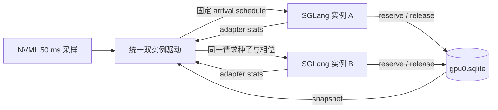

# 同卡双实例验证设计

本文把现有跨进程 VMM broker 从 CPU/单进程测试推进到可执行的双实例 GPU 验证。目标是回答三个相互独立的问题：

1. 两个引擎并发扩张时，broker 是否保证已租用和待映射的 VMM 物理块不超过预算，并在失败路径上不提前释放租约。
2. 在固定总请求集合下，负载反转、并发突发和租户权重变化是否产生预期的准入、拒绝、回收与恢复行为。
3. 这些控制是否带来可观测的服务代价。物理显存下降、不出现 OOM 和吞吐/尾延迟提升必须分别报告，不能互相替代。

## 1. 验证边界

本设计的共同前提是同一张物理 GPU、两个独立 SGLang 进程和同一个 per-GPU SQLite broker 状态文件。模型权重、PyTorch allocator cache、Graph private pool、prefill activation 不计入 broker 容量；broker 只管理显式 VMM-backed KV 租约。

dense V5 与请求级 HiSparse 需要分开验收：

- dense V5 可以在租约申请阶段拒绝增长，但现实现只在实例空闲时回收空块。它不能主动迁移另一个进程里仍存活的请求。
- HiSparse 可以在请求级安全边界降级长驻请求，因此适合验证协作回收、低水位恢复和防抖。
- `enforce` 仅提供软公平。broker 可以拒绝新租约，不能单方面改写另一个进程的 CUDA 映射。

因此，dense 双臂先证明“不会超卖、请求完成、空闲归还”；HiSparse 双臂再证明“压力前降级、释放后恢复”。不能根据 dense 的结果声称已经实现跨实例 live-KV 抢占。

## 2. 实验拓扑与驱动



驱动负责启动两侧、等待 health、执行 warmup、按相位注入请求、持续采样、正常关闭并校验产物。每个 arm 使用全新的输出目录和 broker 文件；不从上一 arm 复用活跃 SQLite 状态。

每次采样至少记录：

- NVML 整卡 used/free bytes；
- 每个实例的 `backed_bytes`、`live_tokens`、映射/回收行为和 admission counters；
- broker 的 `capacity_bytes`、`outstanding_bytes`、`available_bytes`、各租户 usage/target/deficit、starved tenants；
- 每个请求的 submit/first-token/finish、输入/输出 token、TTFT、TPOT、总延迟、stream error 与 OOM/fail-stop；
- 两侧 server pid、启动命令、源码哈希、broker 配置和模型 version。

broker 采样应使用只读 SQLite 连接，不能让 telemetry 获取写锁。snapshot 中按 owner 汇总 lease 类型、租约字节和最近心跳；数据库 WAL 文件和 journal mode 一并写入运行时 manifest。

dense 首轮直接使用现有的 `scripts/run_dual.py`。它已经支持：

```text
--broker-path PATH --broker-mib N
--broker-fair-mode off|observe|enforce
--broker-tenant-a ID --broker-tenant-b ID
--broker-weight-a W --broker-weight-b W
--broker-stale-seconds S --broker-demand-ttl-seconds S --broker-wait-ms N
```

驱动会拒绝已有 broker 文件、非 VMM 模式、两个模型共用 tenant，以及不完整的
broker 参数。它在 `a-hot`、`b-hot`、`both-active` 三个相位同时采样
adapter backing、整卡 NVML 和只读 broker 快照。MiniMax/HiSparse 使用其独立
TP4 runner；在它接入相同的相位驱动前，不能把 dense 结果当成请求级迁移结果。

示例（在宿主机项目根目录运行）：

```bash
bash scripts/container_dual.sh 0 /path/to/huggingface/hub v2 \
  results/dual/fair-observe-3to1 \
  --broker-path /experiment/results/dual/fair-observe-3to1/broker.sqlite \
  --broker-mib 6144 --broker-fair-mode observe \
  --broker-tenant-a qwen-small --broker-tenant-b qwen-large \
  --broker-weight-a 1 --broker-weight-b 3
```

`observe` 跑通后仅改变为 `enforce`，其余参数、模型、工作负载和输出目录规则保持一致。
每次运行必须使用全新的输出目录和 broker 文件。
工作负载可用 `--requests-per-instance`、`--input-tokens` 和
`--output-tokens` 显式配置。结果按模型 config 计算 TP1 dense KV bytes/token，
并记录逻辑相位需求与 broker capacity 的比值；该比值是容量压力上界，
不能替代对齐后的实际 lease 峰值和超卖采样。
`--arrival-delay-a-ms` 和 `--arrival-delay-b-ms` 在统一 barrier 放行后施加
显式到达偏移，用于先占/后发的不公平突发；实际 dispatch skew 写入相位结果。

最小结果结构如下，原始 samples 和 requests 单独保存，汇总只从原始产物生成：

```json
{
  "status": "complete",
  "arm": "fair-enforce",
  "configuration": {"capacity_bytes": 0, "tenants": {}, "weights": {}},
  "capacity": {"a": {}, "b": {}},
  "phases": [{"name": "a-hot", "scenario": "a-hot", "repeat": 1,
              "summary": {}, "idle": {}}],
  "violations": [],
  "source_manifest": {}
}
```

每个相位另写 `repeat-NN-<scenario>.requests.json` 和
`repeat-NN-<scenario>.samples.json`；warmup 使用 `warmup-<scenario>` 前缀。
`results.json` 只保留可聚合摘要和失败证据，避免把高频采样嵌入主结果。
计时相位之外还执行固定提示长度和输出长度的非流式正确性矩阵，完整 token IDs
保存在 `correctness.json`，baseline 与 VMM arm 必须按相同的 prompt/output hash
逐项一致。
服务关闭按逆序逐个执行；任一 teardown 异常都会写入 `violations` 并把最终
`status` 改为 `failed`，避免留下虚假的 complete 结果。
两个服务退出后才采集最终 broker 状态。`sqlite_final` 记录数据库与 WAL
文件信息，`configuration.broker.snapshot_final` 实际查询 owner、lease 和
outstanding bytes；成功实验若仍有 owner/lease，或 broker 状态不可查询，
会自动改判失败。直接驱动 `main(argv)` 的 CPU mock 回归还覆盖了启动失败、
逆序清理和退出后快照的写入顺序。

## 3. Arm 矩阵

所有计时 arm 使用相同的模型、prompt IDs、请求总数、输入/输出长度、arrival schedule、初始权重常驻状态和总 VMM 预算。只有显式的 broker/压力参数不同。

| arm | broker | 租户配置 | 压力路径 | 主要验证 |
|---|---|---|---|---|
| `isolated` | 关 | 无 | 关 | 单实例性能参照 |
| `shared-off` | 开，`off` | 无 | 关 | 全局容量不超卖与先到先得 |
| `fair-observe` | 开，`observe` | A/B 稳定 tenant，1:1 | 开 | 目标份额、demand、`would_yield` 只观测 |
| `fair-enforce` | 开，`enforce` | A/B 稳定 tenant，1:1 | 开 | 欠额租户获得增长机会，超额租户停止新增长 |
| `fair-weight-3-1` | 开，`enforce` | A/B = 3:1 | 开 | 权重目标与 borrow 边界 |
| `adaptive` | 开，`enforce` | A/B 稳定 tenant | 开 | HiSparse 协作 demote/promote 与防抖 |
| `unfair-burst` | 开，`off` | 可选稳定 tenant | 仅接收方开 | A 先占用、B 突发的回收等待和拒绝次数 |

`isolated` 的每个实例使用独立 broker 文件，或者完全不启用 broker；其余 arm 必须使用同一个物理 GPU 的同一个状态文件。`fair-observe` 的容量、负载和 warmup 要与 `fair-enforce` 完全配对，不能只改变容量后再比较。

公平权重只适用于稳定部署主体。A/B 的 tenant id 由驱动显式传入，不能从模型路径或进程名猜测。同一 tenant 的所有进程必须使用相同权重；任一配置不一致时 fail closed。

## 4. 负载相位

建议先使用现有 Qwen3-0.6B-Base / Qwen3-4B、page size 1、Triton attention、eager、关闭 overlap/radix/prefix cache 的配置，避免把尚未覆盖的生命周期混入首个端到端结论。两侧请求都使用确定性的 `input_ids`，每个相位完整保存请求种子和 prompt hash。

每个 arm 包含以下相位，顺序固定，并在不同 repeat 间交替 A/B 顺序以抵消时钟漂移：

1. `warmup-light`：两侧各提交少量短请求，确认 healthy、adapter stats 和 broker owner 已出现。warmup 不计时。
2. `steady-low`：两侧低并发，等待一段稳定窗口。记录 idle backing、租约和整卡基线。
3. `a-hot`：A 达到预设高并发，B 保持低载。验证 A 可在总预算空闲时 borrow。
4. `reverse-transition`：固定 A 的请求已完成后切换到 `b-hot`；也运行相反顺序。验证释放确认后的租约转交。
5. `both-burst`：两侧同时提交，使对齐后的合计需求超过 broker 预算。验证拒绝发生在 `cuMemMap` 前，而不是依赖真实 CUDA OOM。
6. `drain`：等待所有请求完成、GPU 工作同步、VMM unmap/release 和租约清理。记录回收完成时间。

容量压力场景另设 `unfair-burst`：A 先取得大部分可回收 VMM KV，B 随后突发。只有请求级 HiSparse arm 允许在 B 等待期间观察 A 的 safe demotion；dense arm 应记录等待/拒绝，不得伪称已抢占 A 的 live KV。

请求总集合和 token 总量在 `isolated`、公平 observe/enforce、shared-off 之间必须一致。若某 arm 因拒绝而无法在超时内完成，必须保留拒绝和超时作为结果，不能把未提交请求从分母删除。

## 5. 容量与超时参数

broker 容量应先通过设备预算计算，再在所有配对 arm 中固定：

```text
broker_capacity
  = min(experiment_cap,
        device_total - non_vmm_reserved - safety_reserve)

non_vmm_reserved
  = weights + runtime + graph/private pools + activation headroom + trackside reserve
```

`non_vmm_reserved` 不能从 `torch.cuda.memory_reserved()` 直接重复相加。启动完成后以 `cuMemGetInfo`、两实例实际常驻、校准的 prefill peak 和单独测量的 safety reserve 为依据。若无法可靠估计，先用保守容量，并在 manifest 中写清估计来源。

租约预算按实际 VMM chunk 和 K/V plane 对齐后的字节计算。不能使用未对齐的逻辑 KV 需求判断“刚好不超”。首轮 broker 正确性实验固定使用 `EKV_CHUNK_MIB=2`；全部参与比较的 arm 必须一致。若 2 MiB 的控制面开销明显，再以单独的 chunk-size arm 评估 8/32 MiB，不能在同一配对中悄悄改粒度。

`EKV_GLOBAL_BROKER_WAIT_MS` 默认设为 0。只有单独的控制面压力实验才可用非零值，且最大 5 秒；长轮询会阻塞 scheduler 线程，不能把它当作抢占。demand TTL、pressure high watermark、recovery low watermark和最短稳定窗口在 observe/enforce 间固定，并通过反向负载先测出合适的迁移预算。

## 6. 核心验收条件

每个计时 repeat 都应原子写出 `results.json`。只有全部条件通过，arm 才标记为 `valid`。

### 全局不超卖

- 任意采样点和相位结束时，broker `outstanding_bytes <= capacity_bytes`。
- 两张 K/V plane 的 native mapping 总量与各 owner 的租约总量一致；允许短暂“租约已取、尚未 map”的前向差值，不允许反向出现未租约的 map。
- 数据库 `lease_key` 全局唯一；同一 owner 重试同一 key 不重复收费。
- 进程正常退出后 owner、leases、demands 清理；进程被 `SIGKILL` 后对应租约在 stale 检查证明 PID 不存在前继续保留。

### 公平 observe / enforce

- `observe` 的 target、deficit、starved tenant 和 `fair_share_would_yield` 可见，但请求完成率、租约增长和物理 backing 在对应压力时刻与 `shared-off` 一致，除非记录到说明差异的竞争时序。
- `enforce` 下，存在未满足 demand 时，超额 tenant 的新租约申请以 `fair-share-yield` 被拒绝；欠额 tenant 在仍有全局容量时获得准入。
- 1:1 容量预算的整数分配满足 floor/remainder 规则；3:1 的目标比例在允许一个 chunk 跨越份额边界时仍可解释。
- demand 到期后不再永久阻塞空闲租户；仍在重试的实例会续期。

### dense 双实例

- 两侧请求输出与同模型固定池正确性探针对应；至少覆盖三种 prompt 长度、两种输出长度和两个 seed。
- `a-hot`/`b-hot` 均能在另一侧低载时使用超过本地静态份额的容量。
- 负载反转时，低载侧的 VMM backing 在预期 drain 边界下降，随后高载侧取得新租约。
- 同时超预算时，拒绝由 broker 或 native admission 产生，`cuMemCreate`/`cuMemMap` 不返回 OOM；失败请求的状态明确，不能静默丢弃。
- 空闲窗口内 backing 与租约回落，至少保留 sink/配置的 warm chunk。

### HiSparse adaptive

- 高水位触发后，请求在记录的安全边界完成备份和路由切换，再提交 demote；旧映射在备份完成和 GPU 使用同步后才解除。
- 低水位恢复必须满足稳定窗口和最短驻留时间，才能 promote；用相邻采样统计抖动次数。
- 同一请求的完整 GPU/HiSparse 状态在 demote/promote 前后可读，并与 baseline 的生成 token 一致。
- 受压时所有 TP rank 达成一致；任一 rank 缺少 broker snapshot 时 fail closed，不能把缺失当零压力。
- `observe` 不改变请求 placement；`enforce` 只能在记录到 fairness pressure 时拒绝完整 GPU history。

## 7. 指标与统计

吞吐使用完整相位内完成输出 token 数除以 wall time；超时和失败请求保留在完成率分母。TTFT、TPOT 和 E2E 使用同一客户端时间定义，TTFT 阈值在运行前固定，不能看结果后改。样本数有限时报告中位数、p95 和每轮范围；不要宣称生产 p99。

建议主表按 arm 报告：

| 类别 | 指标 |
|---|---|
| 服务 | completed/failed/timeout、tokens/s、TTFT median/p95、E2E median/p95 |
| 显存 | NVML active peak、post-drain idle、各实例 backed bytes、可归还未对齐余量 |
| broker | reserve attempts/admit/deny、平均/最大等待、outstanding peak、owner 数 |
| 公平 | target/usage/deficit、would-yield、yield、demand 次数和 TTL 过期 |
| 迁移 | demote/promote 数、每请求迁移字节、同步/切换耗时、抖动次数 |
| 失败 | OOM、poisoned backing、partial map、stale owner 和 fail-stop 原因 |

配对比较至少包含 `shared-off -> fair-observe`、`fair-observe -> fair-enforce`、`fair-enforce -> adaptive`。三轮结果若方向不一致，应保留全部数据并判断为不确定。

## 8. 结果解释规则

- “没有 CUDA OOM”只能说明发生了准入控制；吞吐提高还需要完成率、时延和总请求集合支持。
- broker 的字节减少不能直接换算成部署成本，除非同一 SLO 下能减少设备数或使用更小显存。
- observe 与 enforce 的差异若主要来自执行顺序或预热，应标记为无效配对。
- 共享静态对照必须说明实际容量，而不能只比较启动参数。
- dense 和 HiSparse 的产物分开；没有请求级迁移证据时，不写跨实例 live-KV 抢占。

## 9. 实施顺序

1. `run_dual.py` 已接入 broker 配置、只读 snapshot、两租户 owner 校验、同步 dispatch barrier、非流式正确性探针、可配置负载/到达偏移与逻辑 KV 压力估算、镜像/源码/模型/GPU/native 运行时溯源、完整 adapter 计数、显式 drain 等待、失败快照和逐相位 raw 文件。三轮测量按 `a-hot, b-hot, both-active` 与 `b-hot, a-hot, both-active` 交替；分阶段 transition 和真实 broker runner 集成测试仍待加入。
2. 先跑 `isolated`、`shared-off` 和 `fair-observe` 的 CPU/单实例兼容检查，确认输出 JSON、租约不超卖和失败路径。
3. 在空闲 A100 上跑 dense 三种 arm 的双实例配对，验证负载反转、同时突发和 drain。
4. 启用 `fair-enforce`，检查公平拒绝和空闲回收；不要在此阶段声称 active KV 抢占。
5. 在 MiniMax HiSparse 环境跑 adaptive 配对，校准 high/low watermark、迁移预算和冷却时间。
6. 最后运行 SIGKILL、partial-map/close 失败和 stale owner 故障注入，确认恢复路径不会超卖。

任何 GPU 实验开始前都要先确认目标卡空闲，记录 GPU UUID、driver、CUDA、SGLang/PyTorch 版本和源码哈希。实验期间不启动未纳入 broker 的其他 GPU 进程；这样“broker 不覆盖外部 allocator”的边界不会被误判为 broker 失败。
