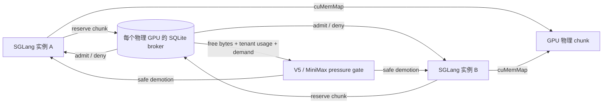

# 跨 SGLang 实例的 VMM 显存协调

这个阶段把每个 SGLang 实例各自维护的 VMM 物理后备，扩展成一个按物理 GPU
共享的准入层。它仍然保留 SGLang 的调度器、注意力内核和逻辑 slot/block；改变的是
`cuMemMap` 之前由谁确认整张 GPU 上还能映射多少物理块。

当前实现解决四件事：

1. 同卡两个实例不会在并发扩池时各自看见同一份空闲显存，然后一起超卖。
2. 一个实例映射或卸载失败时，broker 不会提前释放仍可能被 CUDA 映射的租约。
3. MiniMax 请求级 HiSparse 可以把 broker 的剩余容量当成压力信号，先降级本实例
   的长驻请求，并在容量稳定恢复后再允许提升。
4. 多个模型租户可以按稳定 `tenant_id` 和权重获得软公平份额；等待中的租户会发布
   短期容量需求，超额租户因此在全局显存耗尽前就停止继续增长并进入协作回收。

它还没有实现跨进程强制卸载。一个不参与 scheduler hook 的进程，或仍持有活 KV
的另一个模型，不会被 broker 直接改写。

## 数据流



一条租约的生命周期是：

```text
logical growth
  -> broker reserve
  -> cuMemMap / zero
  -> live KV
  -> cuMemUnmap
  -> broker release
```

租约只在 `cuMemUnmap` 或覆盖整块 native backing 的 close 成功后被释放。批量
映射可能先完成一部分再报错，所以 native 操作失败后不会执行补偿式 release；
这部分容量一直保留到后续 close 成功，或者 owner 被证明已经死亡。

## 两种压力来源

### Dense V5 准入

Dense V5 在 SGLang 调用 allocator `available_size()` 时，同时读取：

- 当前 CUDA 剩余显存；
- 已配置的 prefill headroom；
- 本实例尚未映射的本地预算；
- broker 的全局剩余 VMM 容量。

最终 token 准则取这些约束的最小值。已经映射的空洞和已 precommit 的 chunk 不会
被重复收费。

### MiniMax 请求级 HiSparse

MiniMax 使用两个跨进程水位：

- `EKV_ADAPTIVE_GLOBAL_BROKER_HEADROOM_BYTES`：全局剩余容量低于该值时触发
  pressure；
- `EKV_ADAPTIVE_GLOBAL_BROKER_LOW_BYTES`：容量回升到该值并稳定一段时间后才恢复
  promotion。

低水位必须高于触发水位。这个间隔提供防抖，避免两个实例在 demote/promote 之间
反复切换。实际动作仍然走原有的请求级迁移：选择可回收的物理 chunk、同步设备、
提交路由变化，然后释放。

所有 TP rank 都必须启用 broker。一个 rank 缺少状态时调度器直接失败，不能把它
静默解释成零压力。每个 rank 读取自己物理 GPU 的 broker，再通过现有的 TP
collective 求最紧张状态。

## 带权软公平与防饥饿

公平控制的默认模式是 `off`，保持原来的先到先得语义。`observe` 只计算和导出
“如果 enforce 是否会 yield”，不改变准入；`enforce` 才会限制新租约。

一个 `tenant_id` 表示部署者明确指定的公平主体。同一模型的两个副本既可以共享一个
tenant，也可以使用两个 tenant；broker 不从模型路径猜测。只有当前持有租约或有未
过期 demand 的 tenant 参与当前公平轮次，因此空闲服务不会长期占住份额。一个
tenant 没有竞争时可以借用整张 GPU 的剩余预算。

目标份额按活跃 tenant 的权重划分：

```text
fair_target_i = capacity * weight_i / sum(active_weights)
```

当租约申请因全局容量不足失败时，broker 在同一 SQLite 事务中写入一个有 TTL 的
demand；申请成功后立即清除。另一个超额 tenant 若继续增长，会收到
`fair-share-yield`，直到它通过自己的 scheduler hook 完成 demotion、成功
`cuMemUnmap` 并释放租约。broker 不转交租约，也不直接改写其他进程的 CUDA 映射。

这种算法是软公平，不是硬分区：

- 无竞争时允许 borrow；
- 为保持 VMM chunk 的原子性，一个申请可以从份额下方一次性跨过目标边界；
- demand 过期后自动退出竞争，避免崩溃实例永久冻结资源；
- 权重相同的两个模型在持续竞争时获得近似相同份额；
- 权重不同的模型按比例分配，但获得更高权重的服务仍需自己提供可回收 KV。

`fairness_pressure` 会沿现有 TP collective 取任一 rank 的最紧张值。MiniMax 在
全局可用字节尚未低于普通高水位时，也会因公平欠额触发同一套安全 demotion；
只有公平压力消失且全局低水位保持稳定后才恢复 promotion。Dense V5 的
`available_size()` 同时取设备余量、broker 总余量和当前 tenant 的目标余额，避免
先向 SGLang 分配一个最终无法映射的 batch。

`EKV_GLOBAL_BROKER_WAIT_MS` 可以选择让一次租约申请在有限时间内轮询重试，默认
为 0。最大值为 5 秒；它只适合能容忍 scheduler 线程短暂停顿的部署。Dense V5
通常应依赖准入收缩，MiniMax 应依赖协作 demotion，不应把长轮询当作抢占机制。

## 部署

同一张物理 GPU 上的实例使用同一个状态文件：

```bash
EKV_GLOBAL_BROKER_PATH=/run/ekv/gpu0.sqlite
EKV_GLOBAL_BROKER_MIB=6144
```

公平模式示例：

```bash
EKV_GLOBAL_BROKER_FAIR_MODE=enforce
EKV_GLOBAL_BROKER_TENANT=qwen-a
EKV_GLOBAL_BROKER_TENANT_WEIGHT=3
EKV_GLOBAL_BROKER_DEMAND_TTL_SECONDS=10
EKV_GLOBAL_BROKER_WAIT_MS=0
```

同一 tenant 的所有进程必须使用相同权重。公平模式和权重会写入状态文件，运行中
配置不一致会 fail closed。更换模式或权重应在所有实例正常退出后使用新状态文件，
或者清理已确认无活租约的旧状态文件；不要在不清楚 native mapping 是否仍存活时
直接删除 SQLite 文件来“解锁”。

多卡服务使用 `{gpu}` 模板，或者传入已经存在的目录：

```bash
EKV_GLOBAL_BROKER_PATH=/run/ekv/gpu-{gpu}.sqlite
```

broker 记录 CUDA visibility 或 device UUID。不同物理 GPU 误用同一个状态文件时
会在启动阶段报错，而不是把多张卡错误地压进同一个预算。

建议先从保守容量开始，只把确实可回收的 KV VMM backing 放入预算。权重、
PyTorch allocator cache、Graph private pool 和 activation workspace 仍然由各自
运行时管理。

## 故障与恢复

- 正常 close：先确认 native backing 全部释放，再删除 broker owner 和租约。
- native close 失败：保留租约；对象再次 close 或垃圾回收时可以重试。
- partial map 失败：保留整批租约；`Backing` 变为 poisoned，不能继续执行读写。
- fair-share yield：保留租约不变，只记录短期 demand 并拒绝本次新增长。
- demand 超时：竞争 tenant 退出当前公平轮次；若请求仍在重试，下一次拒绝会
  重新续期。
- 进程崩溃：其他 broker 在 stale 时间后检查 PID 和 boot ID；只有能证明旧进程
  已经消失时才回收租约。
- SQLite close 暂时失败：heartbeat 保持运行，租约不会被误判为死亡。
- live hung process：保守地保留租约。容量可能暂时泄漏，但不会发生跨进程超卖。

## 已知边界

- `off` 模式仍先到先得；`enforce` 只提供软公平，不保证瞬时精确到字节。
- 压力协调依赖实例运行 scheduler hook；它不能控制未接入 broker 的 allocator。
- 没有跨进程 live-KV 传输，也没有可由 broker 单方面触发的 safe preemption。
- MiniMax 的 indexer、权重、activation 和 Graph pool 不在当前 VMM 预算内。
- 跨模型共享前缀和“其他实例已驻留的 Top-K chunk”尚未接入。
- 还没有使用真实双实例、多 TP 规模完成端到端时延和 OOM 对照。
- 公平预算仍只覆盖 VMM-backed KV；prefill 激活、权重、PyTorch cache 和 Graph
  private pool 仍是外部预算。

## 下一轮验证

在一个 GPU 上启动两个使用同一 broker 的 SGLang 实例，固定总工作负载：

| arm | broker | 调度压力 | 目的 |
|---|---|---|---|
| isolated | 否 | 否 | 单实例参照 |
| shared-static | 是，off | 否 | 验证不会超卖，但测量先到先得带来的饿死 |
| fair-observe | 是，observe | 是 | 记录目标份额和 would-yield，不改变服务 |
| fair-enforce | 是，enforce | 是 | 检查防饥饿、borrow 和协作回收 |
| shared-adaptive | 是 | 是 | 测量协作 demote/promote 的吞吐与尾延迟 |
| unfair-burst | 是 | 是 | 让 A 静默占住远处容量，B 突发，检查回收延迟 |

每种 arm 都必须记录每个 owner 的租约、broker 等待/拒绝、demotion、promotion、
整卡 NVML、TTFT/TPOT、完成率和 OOM/fail-stop。若 `shared-adaptive` 只是减少
OOM 但显著拖慢正常请求，应保留结果并把 fair-share 单独列为下一步，而不能把
“能跑不 OOM”写成吞吐收益。

CPU 上可以用 `python -m benchmarks.global_broker_latency` 单独测 SQLite 准入
开销。该基准不包含 `cuMemMap`、模型计算或真实双服务竞争，只能用于检查公平查询
是否引入明显控制面退化，不能作为端到端性能结果。

2026-11-09 在 Windows CPU 临时目录上各跑 500 次控制和观测。`reserve+release`
中位数在 `off`、`observe`、`enforce` 下分别为 7.953、7.815、7.915 ms，
单次公平快照中位数分别为 1.452、1.436、1.470 ms；三档之间没有观察到稳定的
额外退化。最大值有数毫秒到数十毫秒的抖动，主要来自 Windows 上反复打开 SQLite
连接及调度噪声，不能外推到 Linux/tmpfs 或 GPU 服务路径。该基准只覆盖控制面，
不包含 `cuMemMap`、模型计算或真实双实例竞争。
[原始结果](../results/global-broker-latency/windows-cpu-20261109.json)
