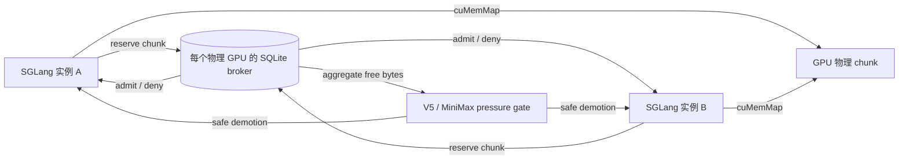

# 跨 SGLang 实例的 VMM 显存协调

这个阶段把每个 SGLang 实例各自维护的 VMM 物理后备，扩展成一个按物理 GPU
共享的准入层。它仍然保留 SGLang 的调度器、注意力内核和逻辑 slot/block；改变的是
`cuMemMap` 之前由谁确认整张 GPU 上还能映射多少物理块。

当前实现解决三件事：

1. 同卡两个实例不会在并发扩池时各自看见同一份空闲显存，然后一起超卖。
2. 一个实例映射或卸载失败时，broker 不会提前释放仍可能被 CUDA 映射的租约。
3. MiniMax 请求级 HiSparse 可以把 broker 的剩余容量当成压力信号，先降级本实例
   的长驻请求，并在容量稳定恢复后再允许提升。

它还没有实现跨进程强制卸载。一个不参与 scheduler hook 的进程，或仍持有活 KV
的另一个模型，不会被 broker 直接改写。

## 数据流



一条租约的生命周期是：

```text
logical growth
  -> broker reserve
  -> cuMemMap / zero
  -> live KV
  -> cuMemUnmap
  -> broker release
```

租约只在 `cuMemUnmap` 或覆盖整块 native backing 的 close 成功后被释放。批量
映射可能先完成一部分再报错，所以 native 操作失败后不会执行补偿式 release；
这部分容量一直保留到后续 close 成功，或者 owner 被证明已经死亡。

## 两种压力来源

### Dense V5 准入

Dense V5 在 SGLang 调用 allocator `available_size()` 时，同时读取：

- 当前 CUDA 剩余显存；
- 已配置的 prefill headroom；
- 本实例尚未映射的本地预算；
- broker 的全局剩余 VMM 容量。

最终 token 准则取这些约束的最小值。已经映射的空洞和已 precommit 的 chunk 不会
被重复收费。

### MiniMax 请求级 HiSparse

MiniMax 使用两个跨进程水位：

- `EKV_ADAPTIVE_GLOBAL_BROKER_HEADROOM_BYTES`：全局剩余容量低于该值时触发
  pressure；
- `EKV_ADAPTIVE_GLOBAL_BROKER_LOW_BYTES`：容量回升到该值并稳定一段时间后才恢复
  promotion。

低水位必须高于触发水位。这个间隔提供防抖，避免两个实例在 demote/promote 之间
反复切换。实际动作仍然走原有的请求级迁移：选择可回收的物理 chunk、同步设备、
提交路由变化，然后释放。

所有 TP rank 都必须启用 broker。一个 rank 缺少状态时调度器直接失败，不能把它
静默解释成零压力。每个 rank 读取自己物理 GPU 的 broker，再通过现有的 TP
collective 求最紧张状态。

## 部署

同一张物理 GPU 上的实例使用同一个状态文件：

```bash
EKV_GLOBAL_BROKER_PATH=/run/ekv/gpu0.sqlite
EKV_GLOBAL_BROKER_MIB=6144
```

多卡服务使用 `{gpu}` 模板，或者传入已经存在的目录：

```bash
EKV_GLOBAL_BROKER_PATH=/run/ekv/gpu-{gpu}.sqlite
```

broker 记录 CUDA visibility 或 device UUID。不同物理 GPU 误用同一个状态文件时
会在启动阶段报错，而不是把多张卡错误地压进同一个预算。

建议先从保守容量开始，只把确实可回收的 KV VMM backing 放入预算。权重、
PyTorch allocator cache、Graph private pool 和 activation workspace 仍然由各自
运行时管理。

## 故障与恢复

- 正常 close：先确认 native backing 全部释放，再删除 broker owner 和租约。
- native close 失败：保留租约；对象再次 close 或垃圾回收时可以重试。
- partial map 失败：保留整批租约；`Backing` 变为 poisoned，不能继续执行读写。
- 进程崩溃：其他 broker 在 stale 时间后检查 PID 和 boot ID；只有能证明旧进程
  已经消失时才回收租约。
- SQLite close 暂时失败：heartbeat 保持运行，租约不会被误判为死亡。
- live hung process：保守地保留租约。容量可能暂时泄漏，但不会发生跨进程超卖。

## 已知边界

- 准入是先到先得，没有固定的每模型 fair share。
- 压力协调依赖实例运行 scheduler hook；它不能控制未接入 broker 的 allocator。
- 没有跨进程 live-KV 传输，也没有可由 broker 单方面触发的 safe preemption。
- MiniMax 的 indexer、权重、activation 和 Graph pool 不在当前 VMM 预算内。
- 跨模型共享前缀和“其他实例已驻留的 Top-K chunk”尚未接入。
- 还没有使用真实双实例、多 TP 规模完成端到端时延和 OOM 对照。

## 下一轮验证

在一个 GPU 上启动两个使用同一 broker 的 SGLang 实例，固定总工作负载：

| arm | broker | 调度压力 | 目的 |
|---|---|---|---|
| isolated | 否 | 否 | 单实例参照 |
| shared-static | 是 | 否 | 验证不会超卖，但测量先到先得带来的饿死 |
| shared-adaptive | 是 | 是 | 测量协作 demote/promote 的吞吐与尾延迟 |
| unfair-burst | 是 | 是 | 让 A 静默占住远处容量，B 突发，检查回收延迟 |

每种 arm 都必须记录每个 owner 的租约、broker 等待/拒绝、demotion、promotion、
整卡 NVML、TTFT/TPOT、完成率和 OOM/fail-stop。若 `shared-adaptive` 只是减少
OOM 但显著拖慢正常请求，应保留结果并把 fair-share 单独列为下一步，而不能把
“能跑不 OOM”写成吞吐收益。
