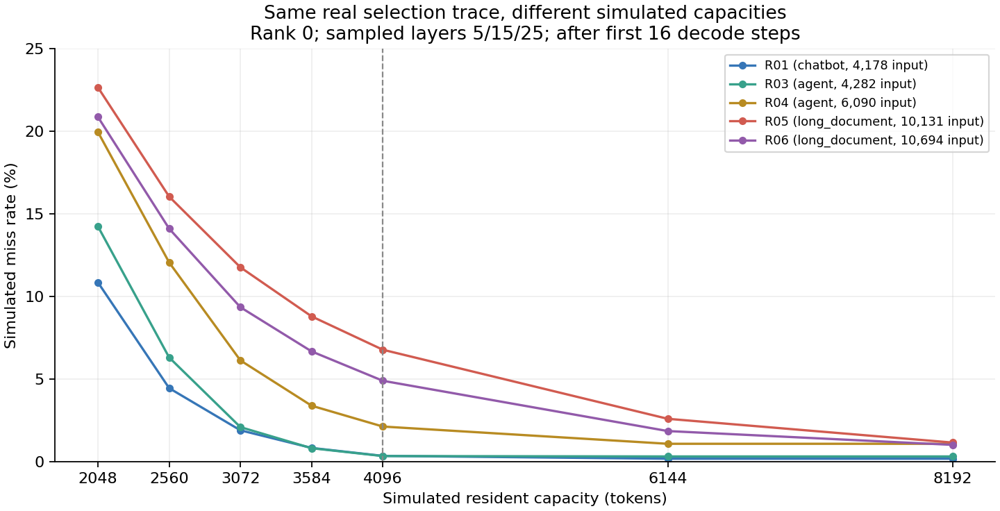
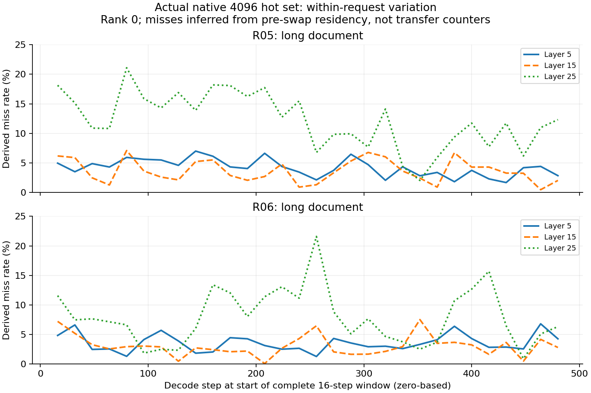

# 真实请求的 HiSparse 驻留局部性：首轮结果

2026-11-11。固定 MiniMax-M3.1-Flash、A100 TP4；本报告对应真实数据的局部性诊断，未测端到端加速。

首轮支持继续研究请求级驻留预算：请求之间以及同一请求内部存在不同的缺失率，模拟扩容对长文请求更有帮助。但“当前 miss 很低”不等于容量可以直接减半；等预算分配也需要限制单请求退化，避免只改善总量却损害短请求。

## 实验和指标

GPU 4–7 经两次间隔至少 60 秒的空闲查询后启动。使用固定只读模型、固定镜像并记录关键源码哈希、TP4、Top-K 2048、原生热集 4096；诊断采用 eager、关闭 overlap/radix/spec，沿用 SM80 BF16 投影适配。来源、revision、筛选规则及两次启动失败见 [实验方案](HISPARSE_LOCALITY_STUDY.md)。定期资源检查自动化在本次启动时已删除；每次新服务仍检查稳定空闲，未恢复旧 r9 队列。

6 条请求来自 5 个独立来源；SWE-agent 的两条请求是同一轨迹的不同检查点，只回放文本，不执行工具。24 条候选经真实 tokenizer 筛选得到 12 条 4K–12K 输入，首轮每类取 2 条。数据原标签表明两条聊天均为 English，两条长文均为 Multi-Document QA / Legal；本轮并未覆盖多个长文领域，不能声称已证明不同话题的差异。原始数据和可还原文本的 token IDs 留在私有容器工作区。

| 请求 | 类型 | 来源组 | 输入 token | 输出 token | 停止原因 |
|---|---|---|---:|---:|---|
| R01 | WildChat 聊天 | G01 | 4178 | 376 | 自然停止 |
| R02 | WildChat 聊天 | G02 | 7629 | 13 | 自然停止 |
| R03 | SWE-agent 轨迹 | G03 | 4282 | 123 | 自然停止 |
| R04 | SWE-agent 轨迹 | G03 | 6090 | 73 | 自然停止 |
| R05 | LongBench-v2 长文 | G04 | 10131 | 512 | 输出上限 |
| R06 | LongBench-v2 长文 | G05 | 10694 | 512 | 输出上限 |

采样 rank 0/1、层 5/15/25，共 9618 条访问记录。请求、rank、层、step 覆盖通过，无截断；完整性限于该采样配置。首 16 个 decode step 单列，仍参与模拟状态更新；下面的稳态统计排除这 16 步。因此 R02 没有稳态样本，不能隐去它或把聊天稳态均值解释为多条独立请求的均值。

- **原生推导缺失率**：有效选中逻辑 token 在调用前驻留表中未命中的比例，处理最新 token 和短序列快路径。来自真实运行的状态，未直接测量 H2D 次数、字节或耗时，也未覆盖 staging 开销。
- **同轨迹容量模拟**：固定真实 Top-K 选择流，按请求/层/rank 从空状态执行批量 token-LRU。初始状态、prefill 预置热集、最新 token 保留槽及替换规则与原生缓存有区别。
- **原生容量对照**：单独启动不同热集大小的服务。自由生成若产生不同输出，要单列并检查相同前缀和选集，不能直接归因于容量。

两 rank 的 4809 个对齐位置中有 4713 个选中集合不同，含义是至少一个成员不同，不是 98% 的 token 不同。主表使用 rank 0；rank 1 单列，不据此外推全部四个 rank。

## 请求之间的容量敏感性

下表合并 rank 0 的三个采样层，按有效选择 token 数加权。只有“原生 4096”来自真实驻留状态，其余列均为同轨迹模拟，单位为百分比。

| 请求 | 原生 4096 推导 | 模拟 2048 | 模拟 3072 | 模拟 3584 | 模拟 4096 | 模拟 6144 | 模拟 8192 |
|---|---:|---:|---:|---:|---:|---:|---:|
| R01 聊天 | 0.28 | 10.85 | 1.90 | 0.83 | 0.35 | 0.18 | 0.18 |
| R03 agent | 0.18 | 14.24 | 2.09 | 0.81 | 0.34 | 0.31 | 0.31 |
| R04 agent | 1.96 | 19.95 | 6.13 | 3.38 | 2.12 | 1.08 | 1.08 |
| R05 长文 | 6.67 | 22.65 | 11.76 | 8.79 | 6.77 | 2.59 | 1.15 |
| R06 长文 | 4.84 | 20.86 | 9.35 | 6.67 | 4.89 | 1.85 | 1.01 |

扩容 4096→8192 对 R05/R06 的模拟缺失率分别降低 5.62/3.88 个百分点，对 R01/R03 仅降低 0.17/0.02 个百分点。这说明应观察容量的边际收益，不能仅按请求长短或当前缺失率分配。

负结果同样明确：五条有稳态数据的请求在 4096→2048 后，模拟缺失率都增加超过 5 个百分点。即使 R01/R03 原生 miss 很低，也不能直接减半。温和缩容 4096→3584 时，这两条分别只增加 0.4815/0.4745 个百分点，减少 12.5% 的驻留 token 容量；这还不是实际回收了 12.5% HBM 的证明。

rank 1 上也观察到相同方向：聊天/agent/长文原生推导率为 0.25%/0.95%/4.21%，模拟 4096 为 0.34%/1.16%/4.26%，模拟 8192 为 0.18%/0.49%/0.97%。具体值不同，应保留 rank 差异。

## 同一请求内部的阶段变化

图中只画两个长文请求，分别展示三个采样层；每一点是排除首 16 步后的完整 16 步窗口。R05 的第 25 层原生推导 miss 为 2.01%–21.09%，R06 同层为 0.88%–21.59%。这是相同请求、相同层随时间的变化，不能与不同层之间的差异混为一谈。

这支持“请求内部可能需要调整驻留”的动机，但尚未证明阶段可预测，也未证明扩大驻留能消除每一次峰值。在线策略应只看历史窗口，并考虑窗口滞后、防抖、扩缩容成本和实际可释放物理 chunk。

## 相同预算下能得到什么

把五条有稳态数据的串行轨迹假想为同时驻留，预算固定为 5×4096=20,480 token。枚举 2560/3072/3584/4096/6144/8192 的精确等预算组合，共 341 种。两个已采 rank 使用同一个分配；未采 rank 2/3，因此不是 TP4 最优。

| 事后选出的分配目标 | 总选择 token 加权缺失率 | 请求等权缺失率 |
|---|---:|---:|
| 每请求均为 4096 | 3.5022% | 2.6333% |
| 最小化总缺失 | 2.5928% | 3.0481% |
| 最小化请求平均缺失率 | 2.7842% | 2.5967% |

总缺失最优分配为 R01/R03/R04/R05/R06 = 4096/3072/3072/6144/4096。它让两条 agent 检查点的模拟率分别从 0.36%→2.24%、2.37%→6.17%。因此总量改善存在牺牲短请求的可能。请求等权最优分配为 3072/3584/3584/6144/4096，按请求平均的提升只有 0.0366 个百分点。

这些是**知道完整访问流后选出的离线分配**，并非在线控制器收益；串行轨迹没有实际同时运行，token 预算不是测得的物理显存预算，未模拟迁移和调度开销。五条均有效请求的分析没有包含提前 EOS 的 R02。每 rank 独立 oracle 及共同分配详细计数见 [等预算结果](../results/locality-pilot-20261111/equal-budget-oracle.json)。

## 三种原生容量的独立服务对照

同四张 GPU 再次满足稳定空闲门槛后，在新容器完成 8192 驻留的六条真实输入，8256 条访问记录，覆盖通过。物理池和逻辑容量仍分别为 32768/65536，原生 block 张量宽度仍是 16×128=2048。

随后 2048 原生容量也完成六条请求，9792 条记录，覆盖通过，最大 block 宽度和有效选集仍为 16×128 / 2048。三组累计 18 次请求执行，仍然只有六条不同输入和五个来源，不能算作 18 个独立样本。三个服务均已正常退出，没有遗留 GPU 实验进程。

| 请求 | 4096 输出长度 | 8192 输出长度 | 4096 原生推导 miss | 8192 原生推导 miss | 相同输出前缀 token |
|---|---:|---:|---:|---:|---:|
| R01 | 376 | 134 | 0.28% | 0.00% | 0 |
| R02 | 13 | 13 | 无稳态样本 | 无稳态样本 | 13（完整相同） |
| R03 | 123 | 142 | 0.18% | 0.00% | 30 |
| R04 | 73 | 69 | 1.96% | 0.00% | 60 |
| R05 | 512 | 512 | 6.67% | 1.03% | 33 |
| R06 | 512 | 512 | 4.84% | 0.90% | 147 |

miss 使用各跑次自己的自由生成轨迹、rank 0、采样层、排除首 16 步，**不是相同访问流的因果对照**。R01/R03/R04 的完整上下文可放入 8192 缓冲，原生短序列快路径没有推导缺失；这未计入 staging。前文的模拟 8192 使用 4096 跑次的选择流、从空状态启动，与原生 8192 的轨迹和状态口径均不同，不能仅凭二者差异证明 prefill 的作用。仅 R02 输出完全一致，且没有稳态 decode 样本。相同贪心设置不保证本 SM80 适配组合的输出逐字一致，差异不能单凭此表归因于热集容量或断言正确性损坏。

另核验相同输出历史且当前选集完全一致的位置。R06 在去首 16 步后有 243 个配对层/step，482360 个相同选中逻辑 token，缺失数为 17806→3210（3.69%→0.67%）；R05 有 28 个配对位置，54974 个 token，3228→668（5.87%→1.22%）。这比直接比较自由生成均值更可比，但先前选择和缓存状态仍可能不同，不能等同于严格固定访问流的实验。[匿名配对证据](../results/locality-pilot-20261111/native4096-vs8192.json)保留所有请求和两个 rank，包括没有可配对数据的情况。

2048 原生跑次的 rank 0 稳态推导率为 R01 10.94%、R03 13.40%、R04 19.14%、R05 22.21%、R06 20.90%；R02 仍因只有13个输出而没有稳态样本。对应输出长度为408/13/120/73/512/512。R04 的2048与4096输出完全相同；其余除R02外仍有输出差异。缩小热集后的高miss方向与同轨迹模拟一致，但自由生成均值不是固定轨迹因果估计。全部三组、逐请求、两rank及配对分母见[原生容量比较](../results/locality-pilot-20261111/native-capacity-comparison.json)。

## 当前边界和下一步

1. 三种原生固定容量的初步诊断已完成，同输入、已记录源码哈希与容量门槛通过。后续若要估计纯容量效应，应使用强制相同输出/相同选择轨迹的原生回放；当前完整输出一致的稳态样本很少。
2. 扩大独立来源数，匹配输入长度再比较任务类型。当前长文更长，无法把差异单独归因于话题或“agent/chatbot 类型”。当前逐请求差异指容量敏感性，串行且禁用 radix 的实验没有测跨请求 KV 复用。
3. 用早期窗口选择跨 rank 一致分配，在后续窗口验证；限制每请求退化幅度。若允许中途切换，必须模拟真实迁移和已有热状态，不能拼接不同固定容量的最有利状态。
4. 最后接入可变热集与 VMM 物理预算，测迁移、回收粒度和无插桩 E2E。VMM 本身不会自动使原生 JIT 热集形状动态化。

原生固定池仍为 32768，逻辑容量 65536。hot8192 每条饱和请求还需保留 128 槽，四条需 33280，超过物理池；本轮串行诊断不能据此声称支持四条饱和并发。当前运行均有诊断插桩，不报告吞吐提升。

## 可复现产物

- [匿名统计](../results/locality-pilot-20261111/summary.json)：移除逐步原始 token IDs；附 rank 0 原生 16 步窗口作图数据。
- [运行溯源](../results/locality-pilot-20261111/provenance.json)：三种容量、实际池大小、覆盖和关键源码哈希；哈希范围是运行器记录的文件，不是完整递归源码冻结。
- [模拟等预算枚举](../scripts/compare_hisparse_locality_allocations.py)；[作图脚本](../scripts/plot_hisparse_locality.py)。
- 私有原始跑次：`pilot-retry2-20261111/20261110T174134Z-2e5efd4c`；完整分析：`pilot-retry2-20261111-r2`。
- 采集器 SHA256：`bddda11b54882e869e8fcfa4f54d76133f420e8d119e2aeaa49385b4e971496f`。
- 初始两次 0 请求/0 trace 失败完整保留；这次真实启动、请求生成和完整采集均通过，不能再沿用“修复未验证”的旧状态。
