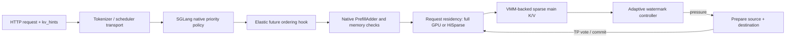

# MiniMax VMM、请求级 HiSparse 与未来调度联合实验

本报告记录一组在真实 MiniMax-M3.1-Flash 服务中完成的最小集成矩阵。它不是把所有功能放在同一张架构图上的模拟：SGLang 原生稀疏 Top-K、HiSparse、VMM 物理 backing、请求级完整驻留、自动高低水位迁移，以及 future-aware 排队逻辑都运行在同一个服务进程组内。

## 实验边界

- 机器：8×A100-SXM4-80GB 节点中的 GPU `0,2,3,4`，TP4，eager，关闭 overlap、radix cache、decode/prefill CUDA Graph。
- 模型：只读 MiniMax-M3.1-Flash；固定镜像的本地 image ID 和源码 revision 见[环境记录](../adaptive_environment.json)。
- 公共适配：非专家 MXFP8 投影加载后转 BF16，专家保留 NVFP4 Marlin。所有对照共享这份 A100 SM80 适配，数字不能解释为原镜像原生支持 A100。
- 容量：逻辑 65,536 token，原生 HiSparse 物理池 32,768 token，hot buffer 4,096 token、reserve page 128 token，Top-K 2048 个位置。
- VMM：主稀疏 K/V 按 2 MiB chunk 提交和归还；请求级驻留上限 2，保留 16,384 个逻辑 slot 的 admission reserve。
- 测量范围：HTTP 请求提交至最后一个生成 token。模型加载、编译和 prompt 文本分词不计时。每轮只有一个 repeat；`performance.correctness.json` 的额外校验不计入时间。

## 数据流

future hook 只调整等待队列顺序。模型显存准入仍由 `PrefillAdder` 决定；请求级政策决定完整驻留或原生 HiSparse；VMM 只负责物理 chunk 生命周期。三者共享同一进程，但各自保留清晰的失败边界。

## 非自适应对照

下表使用相同模型、请求、VMM、驻留策略和 warmup，只切换 future policy。三组都是一轮测量，且执行顺序与机器预热状态不同，因此表格是机制证据，不是稳定的性能结论。

| Run | mixed 12K token/s | short concurrent token/s | long concurrent token/s | mixed TTFT median, ms | mixed TPOT median, ms |
|---|---:|---:|---:|---:|---:|
| off r2，较冷 | 14.069 | 27.893 | 22.414 | 3,087.9 | 160.5 |
| deadline r2 | 16.032 | 31.357 | 23.636 | 2,211.8 | 157.6 |
| off r3，预热后 | 16.743 | 32.403 | 24.522 | 2,934.8 | 130.2 |

deadline r2 相对较冷的 off r2 有更高吞吐和更低 mixed TTFT，但预热后的 off r3 吞吐更高，说明先后顺序与稳态差异足以覆盖这组差额。可报告的聚合证据是：future 路径真实执行无异常，short-concurrent 中位 TTFT 在对应 r2 轮次从约 366.8 ms 降至 272.5 ms；不能据此宣称普遍加速。

deadline r2 的 future telemetry 为 84 个 scheduler tick、1 次队列重排；`fallback_exception`、`fallback_invalid_hint` 和 `telemetry_errors` 均为 0。混合队列中没有 planning hint 的原生请求按设计走原子回退。

## 自动请求级迁移

压力组使用 `mixed12k_unequal`。两个长请求分别降级时，保留页与释放页落在共享物理 chunk 中的组合使单请求候选无法归还完整 chunk；联合规划后，一次双请求动作回收 **240 MiB/rank**。每个 rank 在三轮动作中累计释放 480 MiB，随后进入低水位恢复逻辑。

| Run | 自动降级 | 联合动作 | 累计释放/rank | promotion | throughput token/s | TTFT median, ms | TPOT median, ms |
|---|---:|---:|---:|---:|---:|---:|---:|
| future off | 3 | 1 次，双请求 | 480 MiB | 1 | 15.789 | 2,206.6 | 150.3 |
| future deadline | 3 | 1 次，双请求 | 480 MiB | 0 | 15.870 | 1,429 | 172.0 |

同一组内 deadline 把 TTFT 中位数降低约 35%，但 TPOT 中位数增加约 14%，吞吐基本持平。合理结论是 future hint 改变了等待顺序和尾延迟分布，而不是“免费加速”。低水位 promotion 的轮次差异也说明两次运行进入了不同的稳态。

非自适应轮次结束时，每个 rank 的 VMM backing 从约 960 MiB 峰值回到 240 MiB，`owned_pages=0`、`reclaimable_bytes=0`。240 MiB 是 sink、保留映射和驱动粒度等仍存活引用的结果，不能写成“空闲占用为零”。自动压力轮次仍保留相同 sink 基线。

## 请求级驻留提示的下一切片

上面的已测矩阵让 future hint 影响等待顺序，但驻留槽的选择仍沿用长请求默认规则。代码现新增了默认关闭的请求级策略：在请求进入 HiSparse staging 时读取同一 hint 的 `residence`。`host_backed` 主动放弃完整 GPU 槽，`resident` 在有槽和物理 reserve 时请求完整驻留，`auto` 依据预计输出长度与阈值选择。运行入口为 `--resident-hint-policy adaptive`，并要求同时启用 `--future-policy deadline` 与 `--resident-limit`。

当前 `mixed12k_unequal` 的验收设计是阈值 128：一个 12K 输入、64 输出 token 的长请求退到原生热池；另一个 12K 输入、128 输出 token 的长请求可申请驻留。该切片目前只有纯策略、排序和源码接入验证；尚未在独占 A100 上完成 paired run，因此不能把“少占槽”或“命中预期请求”写成性能收益。后续需要同时检查每 rank 的 `future_decision_reasons`、真实驻留层行数、TTFT/TPOT、VMM backing 和整卡 NVML。

使用 `EKV_GLOBAL_BROKER_FAIR_MODE=observe|enforce` 时，请求级驻留决策还会在
staging 前读取本 rank 的 tenant broker 快照。`observe` 只记录本来会回退多少次；
`enforce` 遇到公平压力时，让同一请求在所有 TP rank 一致走 native HiSparse。
这把“全局高负载 -> 请求退化为稀疏路径”前移到请求准入点，避免完整 KV 已经占用后
才进入迁移路径。相关计数为 `global_fair_claim_checks`、
`global_fair_claim_would_yield` 和 `global_fair_claim_declines`。

## 正确性与可复现门禁

- 两组自适应轮次的语义烟测通过，请求 token 数完整。
- 先前自动往返实验已在四个 rank 上逐字节检查 1,511,946,240 B/rank 的完整源/目标历史，错误计数为零；本集成轮次复用同一迁移路径，不重复把累计检查字节写成显存峰值。
- MiniMax 原生 greedy 路径在跨进程随机 token 输入下没有被证明逐 token 确定，因此不能用跨 run 的 token ID 完全相等作为唯一正确性门禁。语义烟测、完整请求计数、迁移 shadow 和数据面计数承担这一角色。
- future policy 只有在 `ticks > 0`、异常/非法 hint/telemetry error 为零时才能进入证据汇总。

## 尚不支持的统一性

当前 VMM 只管理 MiniMax 稀疏主 K/V。indexer K/V、权重、PyTorch 激活/workspace、Graph private pool 和其他模型实例仍由各自 allocator 管理。因此这是一个“VMM 组织的请求级驻留与迁移系统”，还不是覆盖整张 GPU 的全局内存 broker。跨实例实时抢占、prefill 激活硬预算、软件页表移除和稀疏连续前缀树的非页对齐都属于后续研究。

原始 JSON、参数 manifest 和语义结果保存在 [`results/integration-hisparse/`](../results/integration-hisparse/)。失败 attempt 的目录仍保留在实验机，不进入正式汇总。
