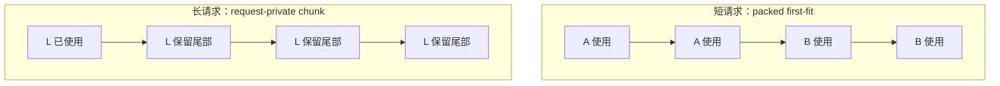
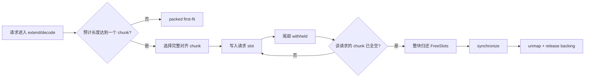

# Request-affine VMM placement

## 这项机制解决什么

普通 first-fit token allocator 只保证逻辑 slot 不冲突。两个请求的尾部可以落在同一个 VMM 对齐 chunk 中，因此一个请求结束时，它使用的 slot 虽然已经空闲，整个物理 chunk 仍不能 unmap。这个耦合会让“请求已经结束”和“物理显存可以回收”成为两件不同的事。

request-affine placement 在 VMM chunk 边界上增加请求归属：

- 预计生命周期达到一个完整 VMM chunk 的请求，占用请求私有的对齐 chunk；
- 尚未使用的 chunk 尾部仍属于该请求，不再交给其他请求 packed；
- 仍在私有 chunk 中的部分释放继续 withheld，直到整个 chunk 为空；
- 整个私有 chunk 为空后一次性归还逻辑范围，并在安全边界同步后 unmap/release 物理 backing；
- 短请求继续走原有 packed first-fit，避免每个小请求都浪费一个 chunk。

这里的“私有”指 **VMM logical chunk 的请求归属**。SGLang 仍然使用 token slot ID、request-to-token 表和 attention kernel 的间接寻址，所以这不是“取消 SGLang 软件分页”或“取消所有软件页表”。

## SGLang 接入位置

SGLang 的通用 token allocator 只收到 token 数量，拿不到请求身份。适配器按版本在选择批次的入口注入 request demand，然后仍调用原有 allocator：

| SGLang 路径 | 注入位置 | 当前状态 |
|---|---|---|
| 0.5.2 | `ScheduleBatch.alloc_token_slots()` | API 测试覆盖 extend/decode 请求身份恢复 |
| 0.5.17 `KVCacheConfigurator` 路径 | `schedule_batch.alloc_for_extend()` / `alloc_for_decode()` | 无 GPU 容器集成测试覆盖 |

注入内容是 `request_id`、本次需要分配的 token 数以及预计最终序列长度。底层 `ObservedAllocator.alloc()` 仍返回普通 token slot tensor，不改 attention kernel。

### 预计最终长度

- extend：当前 prompt 长度加剩余 `max_new_tokens`；
- decode：当前序列长度加尚未生成的 output token 数；
- 已经生成的 output token 不再重复计入，避免短请求随 decode 推进被错误升级为私有长请求。

## 布局

下例把 VMM chunk 画成 4 个 token slot；实际大小由 2 MiB VMM chunk、K/V plane 数和一个 token row 的字节数共同决定。



packed chunk 的回收条件是 A 和 B 都结束；private chunk 只等待 L 结束。该设计用一部分尾部容量换取可预测的单请求回收。



## 三种模式

| 模式 | 行为 | 用途 |
|---|---|---|
| `off` | 保持 SGLang/V5 packed first-fit | 默认和生产对照 |
| `dry_run` | 不改 placement，把 allocation tensor 拉回 CPU，统计跨请求共块 | 先看负载中是否存在可回收耦合 |
| `enforce` | 长请求私有 chunk，短请求 packed | 验证 request-affine 路径 |

启动示例：

```bash
elastic-sglang \
  --elastic-mode v5 \
  --elastic-request-affine-mode dry_run
```

确认共享频率后切换：

```bash
elastic-sglang \
  --elastic-mode v5 \
  --elastic-request-affine-mode enforce
```

对应环境变量为 `EKV_REQUEST_AFFINE_MODE=off|dry_run|enforce`。该模式只允许和 V5 一起启动。

## 物理准入与失败边界

原有 physical admission 按 token 范围估算 first-fit 首次触达的 chunk 数；request-affine 可能让两个各含一个 token 的长请求占用两个完整 chunk。若只比较短请求的 token 数，会低估物理需求。

`enforce` 在修改 free ranges 之前执行一次对齐 chunk 预检：

- 只计算尚未在全部 K/V plane 上 backing 的 chunk；
- 扣掉预填 activation headroom、整卡可用显存和可选全局 broker 预算；
- 预算不足时不提交私有布局，退回 packed V5；此时仍由原 physical admission 保护写入前 backing。

预检通过后，allocator 还会为 free-range 修改、backing admission 和 planner commit 建立回滚边界。若后续 map、commit 或 tensor 构造失败，不发布半套 slot allocation。底层 VMM 在异常前已经成功的映射允许保留为未来可用 backing；它不会被当成 live KV。

## 遥测

`adapter_stats.json` 中的主要字段：

- `request_affine_calls`
- `request_affine_enforced_calls`
- `request_affine_fallback_calls`
- `request_affine_physical_preflight_calls`
- `request_affine_physical_fallbacks`
- `request_affine_private_requests_allocated`
- `request_affine_free_chunks`
- `request_affine_withheld_slots`
- `request_affine_withheld_release_tokens`
- `request_affine_released_chunks`
- `request_affine_released_chunk_bytes`
- `request_affine_reclaim_sync_ns`
- `request_affine_rollback_calls`

`dry_run` 的 `request_affine_observations`、`request_affine_observed_shared_chunks` 和 `request_affine_observed_maximum_owners` 来自诊断性的 D2H observation，应单独计入分析成本，不能当作零开销在线策略。

## 当前证据与边界

当前自动化覆盖：

- 长/短请求混合布局与跨请求互斥；
- 私有请求增长、部分释放和整块回收；
- 池尾不完整 chunk；
- `FreeSlots` 容量守恒和随机区间测试；
- SGLang 0.5.2 与 0.5.17 请求身份注入；
- physical admission 的私有 chunk 数预检；
- fail-closed 安装和不支持配置拒绝。

这些是 CPU/API 和 SGLang 源码兼容证据。当前没有可用的 5090 CUDA runtime，A100 实验窗口也未用于本改动，因此尚未报告真实 serving 的吞吐、TTFT、TPOT、整卡显存或 mapping 延迟收益。

当前限制：

- 通用适配器仅支持 dense MHA、TP1、page size 1、Triton、BF16；
- radix/prefix cache、HiSparse、hybrid state、PD 和 speculation 仍被拒绝；
- 软件 token slot 和 request-to-token 表仍保留；
- 短请求密集负载会因长请求阈值和尾部对齐损失 packed 容量；
- private chunk 的部分释放会一直 withheld，以提高回收可预测性；
- `enforce` 的物理预检预算不足时回退 packed，因此它不是硬性保证每次长请求都得到私有 chunk。

## 后续研究接口

这一层为后续稀疏注意力研究提供两个明确接口：

1. 请求级 HiSparse 可以在同一物理预算下切换“完整 KV 驻留”和“固定热集 + host-backed history”，私有 chunk 的结束成为 demote/promote 的回收单位。
2. 如果 kernel 能直接消费稳定的 VMM token 基址，下一步可研究跳过部分软件 token-to-physical slot 映射；当前实现不声称已经做到这一点。

性能研究应先做 paired A/B：同一负载分别运行 `off` 和 `enforce`，同时记录请求级延迟、整卡 NVML、VMM backing、private/fallback 次数和回收 sync。仅凭“释放了多少 MiB”不能证明服务收益。
