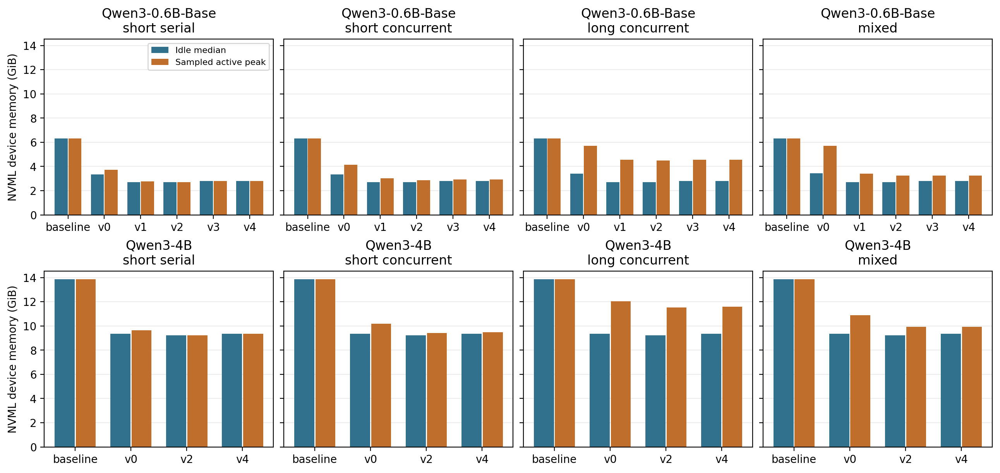
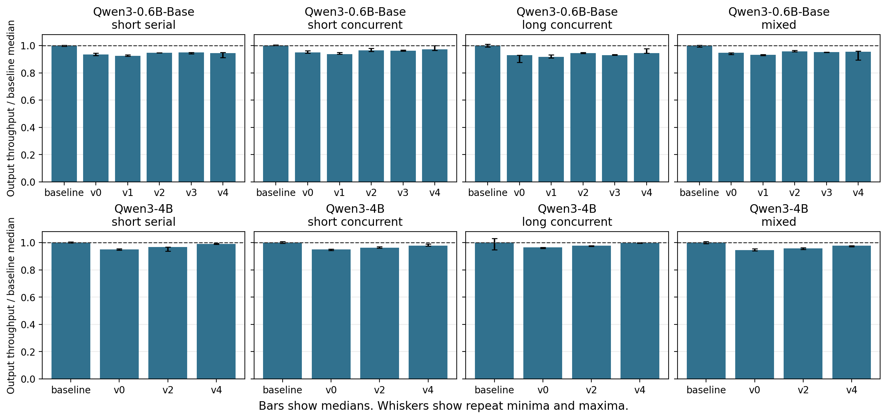

# End-to-end results

The ten arms completed 780 measured HTTP requests, with 78 requests per arm across four workloads and three repeats. The client ran warmups and serial correctness probes separately. In the 120 fixed probes, all 96 elastic-arm output token sequences matched their same-model baseline exactly. Measured request prompt hashes also matched. The HTTP endpoint receives synthetic input IDs, so the timing excludes tokenizer work and the probes measure agreement on these prompts.

V4 reduced sampled whole-device idle memory from 6.304 to 2.804 GiB (55.5%) for Qwen3-0.6B-Base and from 13.85 to 9.35 GiB (32.5%) for Qwen3-4B. The savings during active requests depend on the workload. Median throughput fell by 2.8–5.6% for 0.6B and 0.2–2.3% for 4B. **On the 4B mixed workload, median TTFT increased from 198 ms to 252 ms (about 27%)**, despite the smaller throughput penalty.

## Whole-device memory

Cells give post-request idle median / sampled active peak in GiB. The final column gives V4 active peak reduction against the same workload and model.

### Qwen3-0.6B-Base

| Workload | Baseline idle / peak | V2 idle / peak | V4 idle / peak | V4 peak reduction |
|---|---:|---:|---:|---:|
| short_serial | 6.304 / 6.304 | 2.698 / 2.718 | 2.804 / 2.804 | 55.5% |
| short_concurrent | 6.304 / 6.304 | 2.698 / 2.858 | 2.804 / 2.913 | 53.8% |
| long_concurrent | 6.304 / 6.304 | 2.698 / 4.499 | 2.804 / 4.554 | 27.8% |
| mixed | 6.304 / 6.304 | 2.698 / 3.241 | 2.804 / 3.241 | 48.6% |

### Qwen3-4B

| Workload | Baseline idle / peak | V2 idle / peak | V4 idle / peak | V4 peak reduction |
|---|---:|---:|---:|---:|
| short_serial | 13.850 / 13.850 | 9.214 / 9.237 | 9.350 / 9.350 | 32.5% |
| short_concurrent | 13.850 / 13.850 | 9.214 / 9.421 | 9.350 / 9.491 | 31.5% |
| long_concurrent | 13.850 / 13.850 | 9.214 / 11.530 | 9.350 / 11.600 | 16.2% |
| mixed | 13.850 / 13.850 | 9.214 / 9.913 | 9.350 / 9.913 | 28.4% |

## Serving performance

Each cell gives median output tokens/s / median TTFT (ms) / median TPOT (ms).

### Qwen3-0.6B-Base

| Workload | Baseline | V2 | V4 | V4 throughput change |
|---|---:|---:|---:|---:|
| short_serial | 66.69 / 22.6 / 14.9 | 63.22 / 24.3 / 15.7 | 62.98 / 23.9 / 15.7 | -5.6% |
| short_concurrent | 462.90 / 46.3 / 16.7 | 446.56 / 40.3 / 17.3 | 449.82 / 42.4 / 17.2 | -2.8% |
| long_concurrent | 212.34 / 216.5 / 17.2 | 200.55 / 233.9 / 18.2 | 200.78 / 223.4 / 18.0 | -5.4% |
| mixed | 349.90 / 73.5 / 16.8 | 334.90 / 63.1 / 17.6 | 334.38 / 83.5 / 17.6 | -4.4% |

### Qwen3-4B

| Workload | Baseline | V2 | V4 | V4 throughput change |
|---|---:|---:|---:|---:|
| short_serial | 47.32 / 28.1 / 21.0 | 45.76 / 30.0 / 21.7 | 46.87 / 28.3 / 21.2 | -0.9% |
| short_concurrent | 351.48 / 70.9 / 21.8 | 338.32 / 81.3 / 22.5 | 343.56 / 81.6 / 22.2 | -2.3% |
| long_concurrent | 134.57 / 574.0 / 25.7 | 131.61 / 619.6 / 25.7 | 134.25 / 614.2 / 25.1 | -0.2% |
| mixed | 252.41 / 198.4 / 22.2 | 241.84 / 234.8 / 23.1 | 246.64 / 251.8 / 22.6 | -2.3% |

## Optimization sequence

- **V0** used separate virtual ranges for each layer's K and V planes, with 2 MiB mappings, a device-to-host index transfer at allocation, and prompt reclaim. On 0.6B it lowered the sampled memory peaks in all four workloads relative to the fixed pool and reduced throughput in all four.
- **V1** packed the planes into one token-major virtual range to share mapping granularity. Sampled peaks fell further, including from 5.70 to 3.41 GiB on 0.6B mixed, while median throughput declined from 331.27 to 326.38 tokens/s there and also declined in the other three workloads.
- **V2** reused low slot IDs on the host and prefetched and retained 4 MiB of backing across idle periods to reduce mapping churn. It improved throughput over V1 in all four 0.6B workloads. Mixed reached 334.90 tokens/s and its peak fell to 3.24 GiB.
- **V3** preserved contiguous K and V planes within one reserved virtual range for batched mappings, retained low-ID reuse, and kept one sink chunk per plane when idle. On 0.6B, short serial throughput rose slightly from 63.22 to 63.26 tokens/s versus V2. The other workloads fell, including long concurrent from 200.55 to 197.57 tokens/s.
- **V4** returned a slice of a prebuilt GPU index tensor for contiguous slot allocations, avoiding the host-to-device index transfer and synchronization on that decode path. Relative to V3, 0.6B short concurrent rose from 445.45 to 449.82 tokens/s and long concurrent rose from 197.57 to 200.78 tokens/s. Short serial fell from 63.26 to 62.98 tokens/s. Relative to V2, V4 improved throughput in all four 4B workloads, while on 0.6B V2 remained slightly faster in short serial and mixed.

The comparison shows a usable tradeoff between whole-device memory footprint and serving performance for the tested SGLang configuration. The intervention changes physical backing for the existing KV pool. The experiments do not establish PagedAttention removal, three-pool operation, or research novelty.

## Measurement boundaries

The A100 80 GB runs used eager execution with CUDA graphs, scheduling overlap, and radix caching disabled. GPU clocks were not fixed. Three repeats and small per-workload request counts limit comparisons of small throughput differences and interpretation of p95 latency. NVML samples every 50 ms can miss brief peaks. See [Measurement protocol](MEASUREMENT.md).

## Dual-instance run

Two independent SGLang processes shared one A100, with Qwen3-0.6B-Base on instance A and Qwen3-4B on B. Each active instance served four concurrent requests with 1,024 input IDs and 128 generated tokens each. Each mode completed all nine measured phases and all 48 responses. All measured request prompt hashes matched across modes. Both V2 instances returned to zero live KV tokens in all nine post-phase snapshots.

NVML idle is the median of the final post-phase snapshots. Active peak is the maximum of the samples available when the requests finished, as recorded by the phase sample count. That count marks a client-side snapshot of the sampling buffer rather than a precise GPU event. The earlier raw peak field includes post-request samples and is excluded from this table. Throughput is aggregate across the active instances, reported as the median of three repeat rates. TTFT and TPOT are medians over the requests in each scenario and mode.

| Scenario | Mode | Idle GiB | Active peak GiB | Output tokens/s | TTFT ms | TPOT ms |
|---|---|---:|---:|---:|---:|---:|
| a-hot | baseline | 19.366 | 19.366 | 228.55 | 49.5 | 17.2 |
| a-hot | v2 | 11.123 | 11.612 | 219.02 | 60.3 | 17.9 |
| b-hot | baseline | 19.366 | 19.366 | 167.66 | 168.7 | 22.7 |
| b-hot | v2 | 11.123 | 11.752 | 164.96 | 179.7 | 23.0 |
| both-active | baseline | 19.366 | 19.366 | 318.90 | 120.8 | 20.8 |
| both-active | v2 | 11.123 | 12.225 | 311.35 | 123.1 | 21.5 |

V2 reduced device idle memory by 42.6%. With both instances active, it reduced sampled peak memory by 36.9% and aggregate throughput by 2.4%. In the A-only scenario, median TTFT increased from 49.5 to 60.3 ms. The two processes reclaimed their own KV backing independently. This run measured co-residency and reclaim under normal request completion. Global memory arbitration, preemption, and recovery from device OOM are outside its scope.

Reproduce the tables from the recorded phases with `python benchmarks/summarize_dual.py results/dual`.
