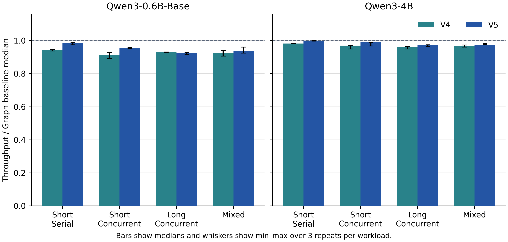
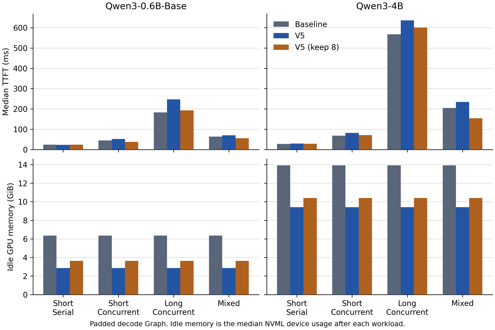
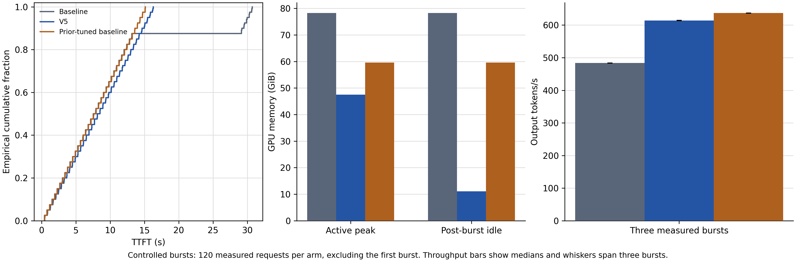

# Phase 2 实验结果

性能主矩阵覆盖 SGLang 15 臂、activation 4 臂和 vLLM 4 臂，每臂 78 个计时请求，共 1,794 个。容量实验另计 360 个稳态请求和 120 个首次突发请求，真实服务压力实验另计 6 个计时请求。预热与正确性探针单独记录。

## 单模型 SGLang

单张 A100-SXM4-80GB，SGLang 0.5.2，PyTorch 2.8.0+cu128。模型为只读 Qwen3-0.6B-Base 与 Qwen3-4B 快照，版本见 environment.json。单模型请求 32,768 KV token slots，context 8192，chunked prefill 2048，mem fraction 0.5。四种负载 short_serial、short_concurrent、long_concurrent、mixed 各测三轮，每轮对应预热单独记录。显存指标来自 50 ms 整卡 NVML 采样。

15 臂由三组 baseline/v4/v5（0.6B eager、0.6B exact graph、4B exact graph）和两组 baseline/v5/v5-keep8（0.6B 与 4B graph-pad）组成。Graph-pad 启用 batch padding，keep8 使用 8 个物理映射 chunk 的保留参数。源码以各臂 source_manifest 的 SHA-256 为准。归档的实验源码分别在 results/phase2/exact-source 与 results/phase2/padded-source，统计取自 results/phase2/summary/summary.json 和同目录 CSV。15 臂各 12 个固定串行 probe 全部通过，汇总中的 7 组跨执行模式探针比较也通过。固定探针提供该批形状与支持范围内的正确性证据。

下表各范围跨四种负载，变化率相对同模型、同执行模式的静态 baseline。吞吐使用各负载三轮的 phase 输出 token/s 中位数。

| 模型与执行 | 实现 | 吞吐变化 | 采样峰值显存变化 | 空闲显存变化 |
|---|---|---:|---:|---:|
| 0.6B eager | v5 | −4.9% 至 −1.8% | −55.5% 至 −27.8% | −55.5% |
| 0.6B exact graph | v5 | −7.3% 至 −1.7% | −54.8% 至 −27.4% | −54.8% |
| 4B exact graph | v5 | −3.0% 至约 0% | −32.3% 至 −16.1% | −32.3% |
| 0.6B graph-pad | v5 | −8.0% 至 +0.3% | −55.0% 至 −27.5% | −55.0% |
| 0.6B graph-pad | v5-keep8 | −3.3% 至 +1.0% | −43.0% 至 −27.5% | −43.0% |
| 4B graph-pad | v5 | −4.3% 至 −1.6% | −32.3% 至 −16.2% | −32.3% |
| 4B graph-pad | v5-keep8 | −3.4% 至 −0.2% | −25.3% 至 −16.2% | −25.3% |

保留 backing 缩小了 graph-pad 并发负载的吞吐损失，同时抬高空闲占用。0.6B long_concurrent 的吞吐相对静态从 −8.0% 收窄至 −3.3%，TTFT 中位从 +34.7% 收窄至 +5.0%。4B mixed 的吞吐差从 −2.7% 收窄至 −0.2%，TTFT 中位从 +14.8% 变为 −24.5%，同一负载的 TPOT 中位变化由 −1.5% 变为 +2.6%。上述点估计来自三轮，未作统计显著性检验。

## 同卡容量准入与突发

同卡先加载 A（0.6B），小请求预热后保持驻留，随后启动 B（4B）并小请求预热。两模型均 eager、关闭 overlap 和 radix cache、Triton attention、page size 1、context 8192、chunked prefill 2048、mem fraction 0.95、max running requests 64。B 突发 40 个并发请求，每个 6,144 输入、512 输出 token。首次突发单列，稳态三轮各 40 个完成请求。跨组核对 request ID 和 prompt 哈希。数据来自 results/phase2/capacity/summary.json 和同目录 CSV，各组源码哈希见各臂 source_manifest。

普通静态与 V5 均为 A/B 请求 327,680 slots。静态 A 的常驻 KV 占用影响 B 启动 profiling，实际只获 234,734 slots。V5 保留两模型的请求容量，B 的实际准入容量比普通静态高 39.6%。强静态对照 baseline-tuned 用已知 A 常驻低载的先验，把 A 请求容量手调为 32,768，让 B 获得 327,680。这组与 V5 的 B 实际容量相同，A 的容量不同。三组用于观察静态分配对同卡准入的影响。

| 组别 | 实际 A / B slots | NVML 活跃峰值 / 结束空闲（GiB） | 稳态耗时中位 [范围]（s） | 稳态输出 token/s 中位 [范围] | 首次突发 s / token/s |
|---|---:|---:|---:|---:|---:|
| baseline | 327,680 / 234,734 | 78.30 / 78.30 | 42.34 [42.34, 42.39] | 483.69 [483.11, 483.72] | 42.38 / 483.30 |
| V5 | 327,680 / 327,680 | 47.51 / 11.09 | 33.35 [33.33, 33.38] | 614.13 [613.62, 614.45] | 33.50 / 611.33 |
| baseline-tuned | 32,768 / 327,680 | 59.60 / 59.60 | 32.15 [32.14, 32.17] | 637.01 [636.63, 637.25] | 32.65 / 627.21 |

V5 相对普通静态吞吐高 27.0%，峰值与结束空闲显存分别低 39.3% 和 85.8%。相对强静态，V5 峰值与结束空闲分别低 20.3% 和 81.4%，吞吐低 3.6%，同时保留了 A 的完整请求容量。空闲占用含两组权重和 VMM 常驻 backing，整卡读数不能直接归为 KV。

| 组别 | TTFT 中位 / p95（s） | E2E 中位 / p95（s） | TPOT 中位 / p95（ms） |
|---|---:|---:|---:|
| baseline | 7.72 / 29.96 | 28.93 / 42.17 | 41.46 / 54.53 |
| V5 | 8.33 / 15.46 | 33.20 / 33.29 | 48.67 / 62.74 |
| baseline-tuned | 7.76 / 14.37 | 31.99 / 32.10 | 47.39 / 60.49 |

V5 对普通静态的 TTFT 和 E2E p95 改善，但 TTFT、E2E、TPOT 中位均变差。批次总耗时下降与单请求中位延迟增加同时发生。V5 对强静态的这三项中位和 p95 均较高。

SLO 同时要求 E2E ≤ 60 s 和对应 TTFT 上限。下表每格依次为三轮合并达标比例、逐轮达标请求/s 的中位数。

| 组别 | TTFT ≤5 s | TTFT ≤10 s | TTFT ≤20 s | TTFT ≤30 s |
|---|---:|---:|---:|---:|
| baseline | 32.5% / 0.307 | 65.0% / 0.614 | 87.5% / 0.827 | 95.0% / 0.897 |
| V5 | 30.0% / 0.360 | 60.0% / 0.720 | 100% / 1.199 | 100% / 1.199 |
| baseline-tuned | 32.5% / 0.404 | 65.0% / 0.809 | 100% / 1.244 | 100% / 1.244 |

5 s 和 10 s 阈值下，V5 对普通静态的达标比例较低，但更短的批次耗时使达标请求/s 较高。20 s 和 30 s 下 V5 两项均较高。强静态在四个阈值下的达标请求/s 均高于 V5。本实验覆盖 A 常驻、B 单边突发，未测两模型同时持续高载。

## vLLM 0.29.0

单张 A100-SXM4-80GB，固定镜像 vllm/vllm-openai:v0.29.0。两种模型各跑原生静态与 VMM，共四臂。每臂使用相同模型快照、eager、TP1、V1 engine legacy runner，关闭 prefix caching 和 async scheduling。两组均为 2,048 个 GPU block，每 block 16 tokens，逻辑池 32,768 slots，最大上下文 8,192。VMM 保留 vLLM 原生软件 block table 和 KV 布局，按 2 MiB chunk 提交物理 backing，worker idle 时同步并回收，block 0 对应的 backing 与首个物理 chunk 保持常驻。

每臂四种负载各三轮，四臂合计 312 个计时请求，预热另记。独立串行正确性检查共 48 个固定探针，其中 VMM 的 24 个探针与各自同模型静态对照逐 token 匹配。下表使用全部 16 个汇总行配对计算。吞吐为各负载三轮的 phase token/s 中位数。显存来自 50 ms 整卡 NVML 采样，正百分比表示节省。延迟变化中的正值表示增加。数据见 [vLLM 汇总 JSON](../results/vllm/summary/summary.json) 和 [CSV](../results/vllm/summary/summary.csv)，实测源码归档见 [tested-source](../results/vllm/tested-source)。

| 模型 | 负载 | 峰值显存节省 | 空闲显存节省 | 吞吐变化 | TTFT 中位变化 | TTFT p95 变化 |
|---|---|---:|---:|---:|---:|---:|
| 0.6B | short_serial | 52.6% | 57.1% | +2.5% | +23.3% | +21.1% |
| 0.6B | short_concurrent | 49.9% | 57.1% | +1.7% | +9.6% | −29.5% |
| 0.6B | long_concurrent | 27.2% | 57.1% | −0.3% | +29.3% | +25.5% |
| 0.6B | mixed | 45.3% | 57.1% | +1.4% | +54.7% | +27.8% |
| 4B | short_serial | 30.1% | 32.7% | −0.1% | +31.4% | +42.3% |
| 4B | short_concurrent | 27.5% | 32.7% | −1.9% | +25.3% | +26.2% |
| 4B | long_concurrent | 15.6% | 32.7% | −3.3% | +12.6% | +10.9% |
| 4B | mixed | 25.9% | 32.7% | −2.0% | −14.5% | −2.7% |

八个负载配对的显存峰值均下降，吞吐变化在 −3.3% 至 +2.5%。七个配对的 TTFT 中位数增加，六个配对的 TTFT p95 增加。该策略在整段繁忙期保留已触及的 backing，因此活跃峰值受繁忙期累计触及的 chunk 数影响。此矩阵覆盖固定逻辑容量下的单模型运行。

## Activation 校准与压力机制

Qwen3-4B graph-pad 的四臂低压模型实验覆盖 telemetry-only 的 prefill chunk 512、2,048、8,192，以及在相同 8,192 chunk 开启 trim 与 flush 的 both 策略。Prefill 峰值增量为观测窗口内 PyTorch peak allocated 减去 prefill 开始前的 allocated，用作 activation 压力的代理量。以 telemetry-8192 的 616.0 MiB 实测峰值向上取整到 64 MiB 边界，再加 128 MiB，得到该实验的 768 MiB headroom。此经验设置随模型和负载变化。

| 策略 / prefill chunk | Prefill 峰值增量（MiB） | long_concurrent 输出 token/s 中位 | TTFT 中位 / p95（s） |
|---|---:|---:|---:|
| telemetry / 512 | 41.0 | 207.31 | 0.788 / 1.264 |
| telemetry / 2,048 | 154.0 | 236.81 | 0.600 / 0.954 |
| telemetry / 8,192 | 616.0 | 243.70 | 0.656 / 0.895 |
| both / 8,192 | 616.0 | 244.30 | 0.662 / 0.893 |

同为 8,192 的比较中，both 相对 telemetry 的 long_concurrent 吞吐变化为 +0.25%，TTFT 中位 +0.87%，p95 −0.25%。12 个固定探针与 11 个 padding 探针均逐 token 匹配。四臂均无压力动作，计数为 0，因而同 chunk 的差异只反映低压条件下的观测结果。数据见 [activation 汇总](../results/phase2/activation/summary.json)。[activation-source](../results/phase2/activation-source) 归档保留实测源码的原始字节。

13 个单元测试通过。独立 synthetic fixture 在同一预占条件下请求映射 2,048 MiB，headroom 为 128 MiB。关闭策略时，原生 `cuMemCreate` 返回 OOM。both 策略回收 254 个可回收 chunk（508 MiB），释放 1,024 MiB PyTorch 非活跃缓存，随后成功映射 1,024 个 2 MiB chunk，两个存活区的 sentinel 值保持不变。该 fixture 验证了受控压力下的 trim、flush 和映射机制。真实模型服务的 OOM 行为需要独立测量。见 [策略关闭](../results/phase2/checks/pressure-off.json)、[both 策略](../results/phase2/checks/pressure-both.json) 和 [单元测试](../results/phase2/checks/unit-tests.txt)。

### 真实服务压力实验

在相同预占负载下，对 telemetry 与 both 各测三个真实服务请求。两臂发请求前的 CUDA driver free 均为 538,509,312 bytes，设定的 prefill headroom 为 768 MiB。64 个输出 token 校验一致，两臂全部完成。

| 策略 | 首次 TTFT（ms） | 后两次 TTFT（ms） | 首次 trim / flush | 整卡 NVML 前后变化 |
|---|---:|---:|---:|---:|
| telemetry | 36.73 | 30.26 / 29.09 | 0 / 0 MiB | 0 MiB |
| both | 68.47 | 28.96 / 28.16 | 1,008 / 0 MiB | −1,008 MiB |

both 首次请求触发一次 trim，实际 NVML 占用降幅与回收量一致，首次 TTFT 增加 31.74 ms。后两次均未再次回收，两臂均未 flush。整卡 NVML 包含实验预占显存。该场景验证服务路径在受控低余量下触发回收及其首请求延迟，因两臂都完成，无法判断策略能否避免模型 OOM。见 [真实服务压力汇总](../results/phase2/prefill-pressure/summary.json)。
